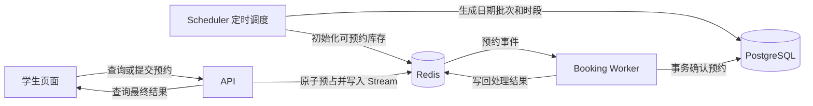

# `apps` 目录三个进程入口详解

> 本文对应当前项目代码，用于阅读源码和课程设计答辩。`apps` 下的三个 `main.py` 分别启动 API、预约 Worker 和定时调度器；具体业务规则主要位于 `src/campus_reserve`。

## 1. 先理解整体结构

| 入口文件 | 进程职责 | 主要依赖 | Docker Compose 实例 |
| --- | --- | --- | --- |
| [`apps/api/main.py`](../apps/api/main.py) | 接收 HTTP 请求，注册接口和中间件 | PostgreSQL、Redis、各业务控制器 | `api-1`、`api-2` |
| [`apps/booking_worker/main.py`](../apps/booking_worker/main.py) | 消费预约事件，把预占结果确认为数据库预约 | Redis Stream、PostgreSQL | `booking-worker-1`、`booking-worker-2` |
| [`apps/scheduler/main.py`](../apps/scheduler/main.py) | 定时生成和同步库存，更新已结束预约的状态 | PostgreSQL、Redis、APScheduler | `scheduler` |

这三个进程并行运行，不是 MVC 的三个层。API 是 HTTP 入口，Worker 和 Scheduler 是后台进程；它们都调用 `src/campus_reserve` 中的模型、服务和基础设施代码。`apps/__init__.py` 及各子目录的 `__init__.py` 是 Python 包标记，不承担上述业务流程。

项目启动时，Compose 先执行数据库迁移 `alembic upgrade head`；迁移成功后启动这些服务。对应配置见 [`compose.yaml`](../compose.yaml)。



## 2. `apps/api/main.py`：接收和响应请求

### 2.1 启动时做什么

1. `get_settings()` 读取配置，随后设置日志格式和级别。
2. 导入 `campus_reserve.models`，确保 ORM 模型被加载。
3. 创建 `FastAPI` 对象 `app`。Compose 用 `uvicorn apps.api.main:app` 启动它，其中冒号后面的 `app` 就是这个对象。
4. 设置生命周期函数：进程开始时记录日志，退出时关闭 Redis 和数据库连接。

### 2.2 对请求做什么

- 配置 CORS，允许本地开发前端访问 API。
- 安装 Prometheus 指标中间件，并暴露 `/metrics`。
- 注册管理员、认证、预约、场地库存、系统状态五组路由。
- 把 `AdminRuleError` 转成结构化 HTTP 错误：不存在时返回 404，其他规则冲突返回 409。
- 提供 `/docs` 和 `/redoc`，便于现场查看接口及参数。

这里负责**装配接口**，不直接编写预约算法。例如，学生提交预约请求的具体处理在 [`bookings/controllers/http.py`](../src/campus_reserve/bookings/controllers/http.py)；库存查询在 [`inventory/controllers/http.py`](../src/campus_reserve/inventory/controllers/http.py)。

### 2.3 答辩时怎么解释

> API 进程是系统对外的入口。它接收前端请求、执行鉴权和参数校验，通过业务服务访问 Redis 或 PostgreSQL，再把结果转换为 HTTP 响应。项目启动了两个相同的 API 实例，由 Nginx 分配请求。

## 3. `apps/booking_worker/main.py`：异步落实预约

### 3.1 为什么需要 Worker

学生提交预约时，API 先通过 Redis 原子检查并占用库存，同时把预约事件写入 Redis Stream。此时请求可能处于 `PROCESSING`，表示**已经受理，但数据库尚未给出最终确认**。Worker 从 Stream 中读取事件，在 PostgreSQL 中完成最终校验和持久化，再写回 `CONFIRMED` 或 `FAILED` 等结果。学生可以凭请求编号继续查询。

相关核心实现：[`redis_reservation.py`](../src/campus_reserve/bookings/services/redis_reservation.py)、[`stream_booking.py`](../src/campus_reserve/bookings/services/stream_booking.py)、[`sync_booking.py`](../src/campus_reserve/bookings/services/sync_booking.py)。

### 3.2 `run()` 的执行顺序

1. 从 `WORKER_CONSUMER_NAME` 获取消费者名称；没有设置时使用主机名。两个 Worker 实例因此能以不同名称加入同一个消费组。
2. 创建 `BookingStreamConsumer`，传入 Redis、数据库事件处理器、Stream 名称、消费组、结果保留时间和最大投递次数等配置。
3. 调用 `ensure_group()`，确保消费组存在。
4. 进入持续运行的循环，写入有效期 30 秒的心跳键，供 Compose 健康检查使用。
5. 优先调用 `claim_stale()`，接管超时未确认的消息；没有这类消息时，调用 `read_new()` 阻塞读取新消息，每次最多读取 10 条。
6. 逐条调用 `process_message()`。处理完成后记录请求编号、持久化状态及是否为重复处理；异常会写入日志，未确认消息留待后续接管。
7. 进程结束时关闭 Redis 和数据库连接。

真正的事件解析、数据库处理、失败补偿、结果写回和 Stream 确认在 [`stream_booking.py`](../src/campus_reserve/bookings/services/stream_booking.py) 中。**Worker 的 `main.py` 主要决定怎样持续消费消息**，不是全部预约规则所在的位置。

### 3.3 答辩时怎么解释

> Worker 负责把 Redis 中的“预约请求”变成 PostgreSQL 中的“正式预约”。两个 Worker 共用一个消费组来分担消息；如果其中一个处理中断，另一个可以接管超时未确认的消息。请求编号和数据库约束用于处理重复投递，前端通过查询接口获取最终结果。

## 4. `apps/scheduler/main.py`：按时间维护系统状态

### 4.1 库存同步

`synchronize_inventory()` 使用项目配置的时区获取当前时间，检查两个目标：**今天**和**开放规则计算出的日期**。当前模板配置为提前一天开放，因此后者通常是明天。

每个日期由 `_synchronize_inventory_for_date()` 处理：

1. 在数据库事务中调用 `InventoryService.synchronize_target()`，生成或复用日期批次及场地时段，并在达到开放时间后放号。
2. 查询该批次库存和已确认预约用量。
3. 对开放的批次初始化 Redis 库存。只有数据库状态为 `AVAILABLE` 且开始时间晚于当前时间的时段，才会在 Redis 中标为可预约；其他时段标为不可预约。
4. 将已确认用量带入 Redis，避免库存同步后丢失用户的预约用量信息。
5. 记录批次、生成情况、放号情况和 Redis 同步结果；配置缺失或同步异常会写入日志。

这项任务会重复执行，但会**复用已有批次**，并不是每 30 秒创建一批新场地。日期、开放时间与时段生成的规则主要在 [`inventory/services/inventory.py`](../src/campus_reserve/inventory/services/inventory.py)。

### 4.2 已结束预约处理

`complete_finished_bookings()` 调用 [`archive_completed_bookings()`](../src/campus_reserve/admin/services.py)，把符合条件的已结束预约更新为 `COMPLETED`，并记录处理数量。它根据时段结束时间处理状态，不负责接收新的预约。

### 4.3 启动与运行频率

`run()` 启动时先执行一次心跳、库存同步和预约完成处理，再用 `AsyncIOScheduler` 注册周期任务：

| 任务 | 间隔 | 目的 |
| --- | --- | --- |
| `write_heartbeat()` | 10 秒 | 更新健康检查心跳 |
| `synchronize_inventory()` | 30 秒 | 补齐和同步库存、检查是否达到放号时间 |
| `complete_finished_bookings()` | 60 秒 | 更新已结束预约的状态 |

每项任务设置了 `max_instances=1` 和 `coalesce=True`，避免同一任务在本进程内重叠执行，并合并错过的运行。进程收到停止信号后关闭调度器、Redis 和数据库连接。

### 4.4 答辩时怎么解释

> Scheduler 是系统的时间驱动进程。它负责确保今天和开放预约日的库存存在，在达到规则规定的时间后放号，并把已结束预约更新为完成状态。它准备和维护预约条件，实际提交预约仍由 API 与 Worker 完成。

## 5. 从一次预约看三个进程怎样配合

1. **准备库存**：Scheduler 在 PostgreSQL 中生成日期批次和时段，并把可预约状态同步到 Redis。
2. **展示库存**：学生页面调用 API。库存接口读取批次及实时状态，展示“可预约”“已预约”“已过期”等信息。
3. **提交请求**：学生选择场地时段，API 调用 Redis 预约服务原子预占库存，并写入 Stream 事件，返回请求编号和当前处理状态。
4. **最终确认**：Worker 消费事件，在数据库事务中校验、创建预约，再写回最终处理结果。
5. **查询结果**：学生页面通过 API 使用请求编号查询，或在“我的预约”中查看已落库的预约。
6. **预约结束**：Scheduler 定期把符合条件的预约状态更新为 `COMPLETED`。

需要区分两个时间点：**Redis 预占成功只说明请求进入处理流程；数据库确认成功才是最终预约成功。**

## 6. 老师现场要求改代码时先找哪里

| 修改需求 | 首先查看 | 通常还需要检查 |
| --- | --- | --- |
| 新增或调整 HTTP 路由 | [`apps/api/main.py`](../apps/api/main.py) 和对应 `controllers/http.py` | 请求/响应 Schema、前端调用 |
| 修改预约资格、冲突或额度规则 | [`bookings/services/redis_reservation.py`](../src/campus_reserve/bookings/services/redis_reservation.py) | Lua 脚本、`sync_booking.py`、相关测试 |
| 修改 Worker 消费批量、心跳或重领节奏 | [`apps/booking_worker/main.py`](../apps/booking_worker/main.py) | `stream_booking.py`、配置项 |
| 修改库存生成日期或任务频率 | [`apps/scheduler/main.py`](../apps/scheduler/main.py) | `inventory/services/inventory.py`、开放模板、库存测试 |
| 修改预约结束后的状态更新 | [`apps/scheduler/main.py`](../apps/scheduler/main.py) | `admin/services.py` 中的归档函数 |
| 修改学生页面文字或状态显示 | [`web/src/App.vue`](../web/src/App.vue) | 库存接口返回值与 Schema |

修改规则时要沿着“前端显示 → API 校验 → Redis 预占 → Worker 数据库确认”检查，避免某一层允许、另一层拒绝。

## 7. 演示和排查命令

在项目根目录的 PowerShell 中执行：

```powershell
# 查看三个进程对应的容器是否正常
docker compose ps

# 分别观察 API、预约处理、库存调度日志
docker compose logs -f api-1 api-2
docker compose logs -f booking-worker-1 booking-worker-2
docker compose logs -f scheduler
```

演示时可先打开 API 的 `/docs` 查看接口，再在学生页面提交预约；查看 Worker 日志中的处理结果和 Scheduler 日志中的 `inventory_synchronized`，就能对应说明三个进程各自做了什么。

## 8. 一分钟总结

> `apps/api/main.py` 负责让系统接收请求；`apps/booking_worker/main.py` 负责把异步预约请求落实到数据库；`apps/scheduler/main.py` 负责按时间生成、开放和同步库存，并更新已结束预约状态。三个入口只组织进程运行，具体业务规则由 `src/campus_reserve` 中的控制器、服务、仓储及 Redis 脚本实现。
