# 校园羽毛球场高并发预约系统项目规划

> 文档版本：v1.2（课程设计 MVP）  
> 技术方向：Python / FastAPI / PostgreSQL / Redis / 消息队列  
> 目标读者：项目开发者、指导老师和课程答辩评审人员

## 1. 项目概述

### 1.1 建设目标

建设一个面向在校学生和场馆管理员的羽毛球场预约平台，支持固定时间集中放号。项目重点研究高并发请求削峰、原子占位、异步落库、幂等和数据库防超卖。在大量学生同时抢订同一批场地时，系统需要做到：

- 不超卖：同一场地、同一时段最多只能生成一个有效预约。
- 公平可控：按请求进入系统的顺序处理，规则公开，失败原因明确。
- 稳定性：热点流量不能直接压垮数据库，依赖短暂异常时请求结果可追踪、可补偿。
- 可追溯：预约、管理员现场签到和后台操作均保留审计记录。
- 可运营：管理员能维护场馆、场地、开放规则和现场签到。

### 1.2 项目边界

MVP 只覆盖一个校园场馆、15 片羽毛球场和学生用户。主链路包括登录、库存查询、高并发抢订、结果查询、预约记录以及管理员现场签到；其他业务不进入当前设计。

### 1.3 术语

| 术语 | 含义 |
|---|---|
| 场馆 Venue | 一个物理体育馆或校区场馆 |
| 场地 Court | 场馆内可独立预约的一片羽毛球场 |
| 时段 Slot | 某片场地在某个固定时间区间内的最小库存单元 |
| 放号批次 Release batch | 一次集中开放预约库存的事件 |
| 占位 Claim | Redis 中对一个或多个时段的短暂原子锁定 |
| 预约 Booking | 学生提交的一次预约请求，可包含同一日期内 1～2 个时段，时段可以不连续 |
| 现场签到 Check-in | 用户到场后，由线下管理员在管理端检索预约并确认到场，不设置签到时间窗 |

### 1.4 已冻结的 MVP 参数

以下内容作为第一期开发和验收基线。业务参数仍通过配置或种子数据保存，不散落硬编码在业务代码中。

| 参数 | 已确定值 |
|---|---|
| 可预约用户 | 学生 |
| 场馆与场地 | 1 个场馆，固定初始化 15 片羽毛球场 |
| 每日开放时间 | 08:00—22:00 |
| 时段长度 | 60 分钟；每片场地每天生成 14 个时段，共 210 个库存时段 |
| 放号时间 | 每天 08:00（以服务器 `Asia/Shanghai` 时间为准） |
| 可预约日期 | 每天放号时开放未来第 2 天的库存 |
| 预约选择 | 单次可选择 1～2 个 60 分钟时段，可不连续，但必须属于同一预约日期 |
| 用户额度 | 每名学生每天累计最多预约 2 个时段，即最多 2 小时；可以分多次提交 |
| 现场签到 | 不设置签到时间窗，只允许线下管理员在管理端手工确认 |
| 容量目标 | 10,000 人同时抢订，峰值 5,000 RPS，0 超卖 |

## 2. 用户与业务角色

| 角色 | 核心权限 |
|---|---|
| 学生 | 登录、查询余量、抢订、查询结果、查看预约记录 |
| 场馆管理员 | 管理唯一场馆及其 15 片场地、现场签到、异常处理 |
| 平台管理员 | 用户角色、全局规则、场馆配置、审计和系统配置 |
| 定时任务/系统 | 生成时段、每日 08:00 放号、释放失败或超时的临时占位、执行对账和状态归档 |

课程设计采用模拟学生账号登录：通过种子数据预置学生和管理员账号，密码只保存哈希值，登录成功后签发短期 JWT。校园身份认证不作为本期依赖。

## 3. 业务规则基线

以下规则已冻结为 MVP 验收口径，并以配置或数据库规则快照实现：

1. 预约窗口：每天 08:00 开放未来第 2 天的场地。
2. 开放时间与库存：唯一场馆每日 08:00—22:00 开放；15 片场地按 60 分钟生成时段。
3. 时段选择：一次选择 1～2 个时段，必须属于同一预约日期，可以不连续；同一请求中的时段不能相互重叠。
4. 用户额度：按预约日期累计，每名学生每天最多确认 2 个时段，即 120 分钟；允许通过一次或两次请求完成。
5. 用户时间冲突：同一学生不能拥有时间重叠的有效预约。
6. 预约确认后不可取消，库存不再回流到可预约状态。
7. 现场签到：不设置签到窗口，只由线下管理员手工操作；学生端不提供签到入口。
8. 幂等：同一个 `request_id` 重复提交只能产生一个结果。
9. 防代抢：账号、设备、IP 分级限流；不把 IP 作为唯一身份依据。
10. 公平性：队列受理只代表“进入处理”，最终以数据库提交成功为准。

## 4. 功能需求

### 4.1 用户端

| 编号 | 功能 | 需求描述 | 优先级 |
|---|---|---|---|
| U-01 | 模拟账号登录 | 使用预置学生账号登录，返回短期 JWT；管理员账号由种子数据单独初始化 | P0 |
| U-02 | 日期查询 | 在唯一场馆内按日期查询 15 片场地的开放状态 | P0 |
| U-03 | 余量查看 | 展示每片场地各时段的未放号、可预约、处理中、已预约、关闭状态 | P0 |
| U-04 | 抢订 | 选择同一日期内 1～2 个时段提交预约，时段可不连续，立即返回排队凭证 | P0 |
| U-05 | 结果查询 | 根据请求编号查询处理中、成功、失败及失败原因 | P0 |
| U-06 | 我的预约 | 查看即将开始和历史预约记录 | P0 |

### 4.2 管理端

| 编号 | 功能 | 需求描述 | 优先级 |
|---|---|---|---|
| A-01 | 场馆管理 | 维护唯一场馆的地址、开放状态、联系方式和公告 | P0 |
| A-02 | 场地管理 | 维护固定 15 片场地的编号、状态和设施信息 | P0 |
| A-03 | 开放模板 | 配置工作日/周末开放时间、时段粒度和放号参数 | P0 |
| A-04 | 库存生成 | 预生成未来若干天的场地时段，支持预览后发布 | P0 |
| A-05 | 放号管理 | 配置放号时间、批次，支持暂停、恢复和紧急停止 | P0 |
| A-06 | 现场签到 | 按预约编号、用户或场地检索预约，由线下管理员手工确认到场；不校验签到时间窗 | P0 |
| A-07 | 数据报表 | 查询预约成功率、场地利用率、竞争冲突率和峰值流量 | P1 |
| A-08 | 审计日志 | 查询规则变更、现场签到和角色变更等操作 | P0 |

### 4.3 系统功能

| 编号 | 功能 | 需求描述 |
|---|---|---|
| S-01 | 时段生成 | 根据开放模板和例外日期生成库存，任务可重跑且不重复 |
| S-02 | 准时放号 | 到达发布时间后原子地将批次切换为可抢状态并预热 Redis |
| S-03 | 请求削峰 | Nginx/API 限流、Redis 原子占位、Redis Streams 异步落库 |
| S-04 | 一致性补偿 | 消息重试、死信处理、占位超时释放、Redis 与数据库对账 |
| S-05 | 状态归档 | 预约时段结束后自动标记 COMPLETED，管理员仍可补录现场签到 |

## 5. 非功能需求

### 5.1 建议容量指标

先以单校区中型系统为基准，压测后再校准：

| 指标 | 目标 |
|---|---|
| 固定场地库存 | 1 个场馆、15 片场地、每天 210 个时段库存 |
| 放号瞬间并发在线 | 10,000 人 |
| 峰值入口请求 | 5,000 RPS |
| 查询接口 P95 | 平时 < 200 ms；峰时 < 500 ms |
| 抢订受理接口 P95 | < 300 ms，仅返回受理/拒绝，不等待完整落库 |
| 结果确认 | 99% 在 3 秒内完成，极端情况下不超过 30 秒 |
| 超卖 | 0 |
| 演示环境 | 单机 Docker Compose，可重复初始化和一键启动 |

### 5.2 其他质量要求

- 安全：密码哈希、JWT、RBAC、参数校验、SQL 注入与 XSS 基础防护。
- 隐私：最小化存储个人信息，日志脱敏，敏感字段加密，按校方制度定期清理。
- 可观测：统一 trace ID、结构化日志、指标、链路追踪、慢查询和队列堆积告警。
- 可维护：API 版本化、环境变量配置、Alembic 数据库迁移和自动化测试。
- 无障碍：核心页面支持键盘操作、清晰状态文本，不只依赖颜色表达库存状态。

## 6. 系统总体结构

### 6.1 推荐技术栈

| 层次 | 推荐方案 | 说明 |
|---|---|---|
| Web 前端 | Vue 3 + TypeScript + Vite + Pinia | 适合管理端和用户端共用组件；也可替换为 React |
| API 服务 | Python 3.12 + FastAPI + Pydantic | 异步 I/O、类型校验、OpenAPI 文档完善 |
| ORM/迁移 | SQLAlchemy 2 + Alembic | 显式事务和数据库迁移 |
| 主数据库 | 单实例 PostgreSQL 16 | 强事务、约束、范围类型和丰富索引能力 |
| 缓存/原子占位 | 单实例 Redis 7 | 热点查询、限流、幂等、短期占位、结果缓存 |
| 消息队列 | Redis Streams | 复用 Redis，完成持久化消息、消费者组、重试和待处理消息恢复 |
| 定时任务 | 独立 Python Scheduler 进程 | 使用 APScheduler 执行时段生成、放号、状态归档和对账 |
| 反向代理 | Nginx | 托管前端静态文件、反向代理 API、基础限流和多 API 容器负载均衡 |
| 压测与指标 | Locust + Prometheus + Grafana | 展示 RPS、延迟、错误率、队列堆积和预约结果 |
| 部署 | Docker Compose | 在一台开发机上一键启动全部组件，便于课程演示和复现 |

### 6.2 MVC 分层架构

本项目采用**前后端分离的 MVC 架构**，并使用 Service、Repository 和 Infrastructure 对经典 MVC 进行工程化扩展。MVC 是系统的主干组织方式：Vue 负责 View，FastAPI 路由负责 Controller，领域对象、业务服务和数据访问接口共同构成 Model。Redis、PostgreSQL、消息队列等技术组件通过基础设施适配器接入 Model，不在 Controller 中直接操作。

| MVC 层 | 项目组件 | 核心职责 | 明确禁止 |
|---|---|---|---|
| View（视图层） | Vue 页面、组件、Pinia、表单与状态展示 | 展示场馆和库存；收集用户输入；展示排队、成功和失败结果 | 不判断最终放号状态；不计算预约额度；不直接访问数据库或 Redis |
| Controller（控制层） | FastAPI Router、Controller、Pydantic DTO、中间件 | 接收 HTTP 请求；认证授权；参数校验；调用应用服务；把领域结果转换为 HTTP 响应 | 不编写库存扣减、预约冲突等核心业务规则；不直接提交 ORM 事务 |
| Model（模型层） | Application Service、领域实体、值对象、策略、Repository 接口 | 执行预约、管理员现场签到、每日两小时额度和状态流转规则；维护事务边界；表达业务数据与行为 | 不依赖 Vue、HTTP、FastAPI 路由等表现层技术 |
| Infrastructure（基础设施扩展层） | SQLAlchemy Repository、Redis Adapter、Redis Streams Adapter、Auth Repository | 实现 Model 定义的数据访问和外部能力接口 | 不反向包含业务规则；不绕过 Model 修改预约状态 |

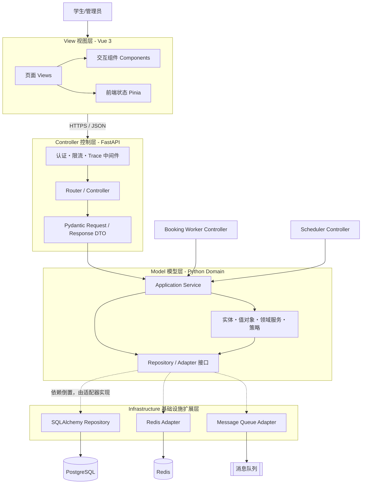

MVC 请求处理方向固定为 `View → Controller → Model → Infrastructure`，返回结果沿相反方向传递。Controller 只做协议层工作，Model 不知道请求来自网页、Worker 还是定时任务，因此同一套预约规则可以被 HTTP 接口、异步消费者和后台任务复用。

对于抢订链路，首次 HTTP 请求仍遵循 MVC：View 提交预约，Controller 校验请求并调用 Model 中的预约受理服务；异步消息由 `Booking Worker Controller` 接收后，再次调用同一 Model 完成数据库确认。Worker 是另一种输入控制器，不是第二套业务逻辑。

### 6.3 逻辑架构图

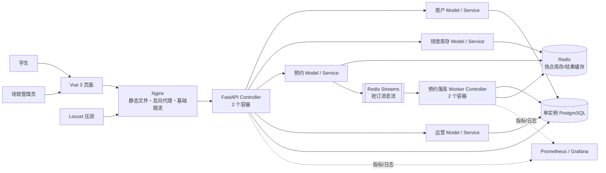

### 6.4 部署结构图

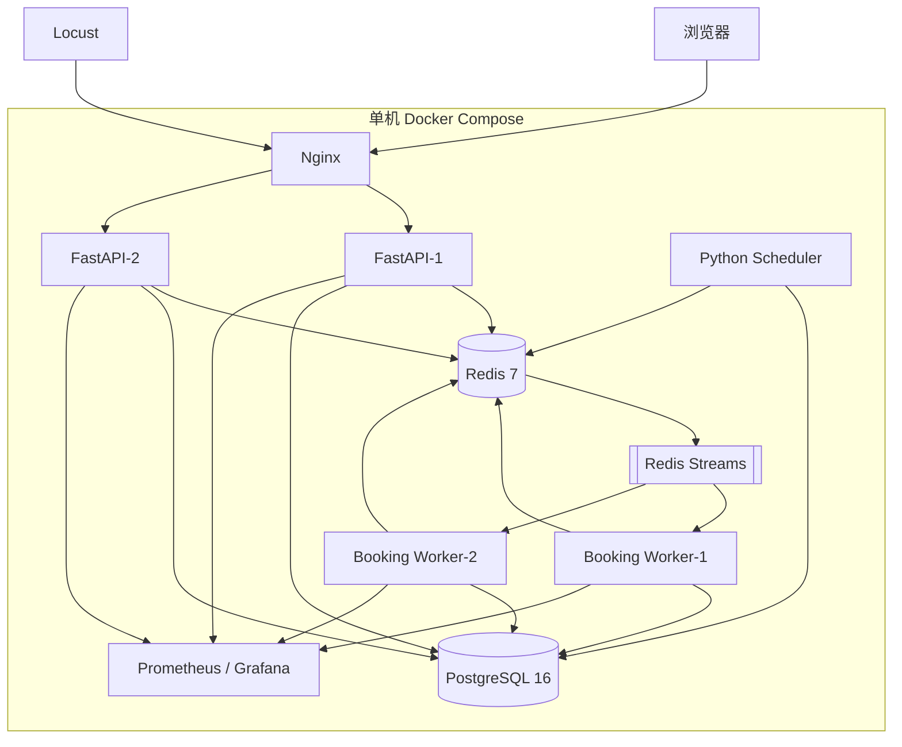

课程设计使用“模块化单体 + 独立抢订 Worker + 独立 Scheduler”。所有组件运行在一台开发机的 Docker Compose 中，通过多个 FastAPI 和 Worker 容器演示水平并发处理。

## 7. 主要模块功能

| 模块 | MVC 归属 | 主要职责 | 关键实现点 |
|---|---|---|---|
| 用户端/管理端页面 | View | 展示库存、预约、管理员现场签到和管理页面，收集操作意图 | Vue Views/Components、Pinia、API Client |
| HTTP 接口 | Controller | 请求解析、认证授权、DTO 校验、错误码和响应转换 | FastAPI Router、Pydantic、中间件 |
| Worker/定时任务入口 | Controller | 消费抢订消息或触发定时任务，调用统一应用服务 | 幂等消费、Trace 透传，不复制业务规则 |
| 身份与权限 | Model + Infrastructure | 模拟账号登录、JWT、角色和数据权限 | 密码哈希、Auth Repository、RBAC |
| 用户与规则 | Model | 学生资料、预约日期累计两小时额度 | 原子额度计数、规则快照、领域策略、审计 |
| 场馆资源 | Model | 场馆、场地、设施、停用状态 | 领域实体、管理用例、乐观锁 |
| 排期库存 | Model | 开放模板、例外日、时段生成、放号批次 | 幂等生成、版本号、状态机 |
| 库存查询 | Model + Infrastructure | 按日期读取时段状态 | Query Service、Redis Adapter、数据库兜底 |
| 预约受理 | Model | 额度、幂等、防刷、原子占位和入队编排 | Application Service 调用 Redis/MQ 接口 |
| 预约落库 | Model | 精确规则校验、事务确认、更新结果 | 有序加锁、数据库条件更新、状态机 |
| 管理员现场签到 | Model | 管理员检索有效预约并确认到场，不设置签到时间窗 | 管理端权限、幂等状态流转、操作审计 |
| 持久化与缓存 | Infrastructure | 实现 Repository、缓存和原子占位接口 | SQLAlchemy、PostgreSQL、Redis Lua |
| 运营管理 | View + Controller + Model | 资源配置、现场签到、并发与利用率报表 | 分层调用、高风险操作二次确认、完整审计 |
| 对账任务 | Model + Infrastructure | Redis/队列/数据库一致性检查 | 定时扫描、补偿、人工处置台 |

## 8. 高并发抢订设计

### 8.1 核心原则

1. 查询与写入分离：余量查询尽量走 Redis，数据库只承担最终确认。
2. 入口快速失败：未到放号时间、身份不合法、已超额度、明显无库存时直接拒绝。
3. 原子占位：一次选择的 1～2 个时段即使不连续，也必须在一个 Lua 脚本内“全成功或全失败”。
4. 异步削峰：占位成功后写入消息流，接口返回 `PENDING` 和请求编号。
5. 数据库兜底：最终事务再次校验时段状态；条件更新行数不符则整单回滚。
6. 幂等到底：Nginx/API、Redis、消息消费者、数据库都识别同一个 `request_id`。
7. 失败可补偿：落库失败释放占位；消费者崩溃可重试；长期未决请求进入对账。

### 8.2 抢订状态机

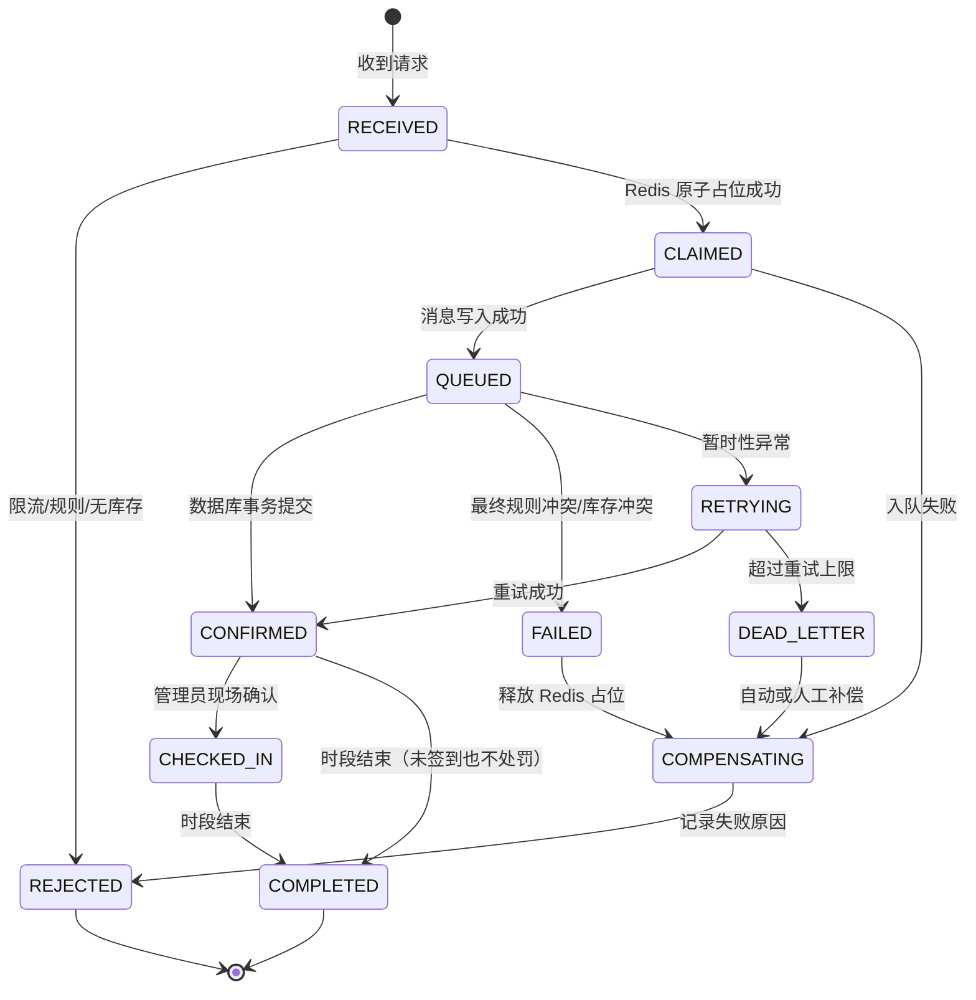

### 8.3 原子占位伪逻辑

Redis key 按放号批次和时段统一命名，例如 `reserve:batch:{batch_id}:slot:{slot_id}`，便于 Lua 脚本批量检查和占位。

```text
输入：request_id、user_id、service_date、slot_ids、claim_ttl、quota_key
1. 若 result:{request_id} 已存在，直接返回已有结果（幂等）。
2. 检查批次状态和服务器时间，未开放则拒绝。
3. 验证 slot_ids 数量为 1～2，属于同一 service_date，时段之间不重叠；不要求连续。
4. 检查用户速率、当前请求数，以及 quota:{user_id}:{service_date} 的已确认与待确认时段数。
5. 若“已使用时段数 + 本次时段数 > 2”，返回 USER_DAILY_DURATION_EXCEEDED。
6. 按固定顺序检查所有 slot key 是否 AVAILABLE。
7. 任一不可用：整单拒绝，不改变任何库存或额度。
8. 全部可用：原子占位所有 slot，并为当天额度增加本次时段数，二者设置同一 request_id 和补偿信息。
9. 写入 result:{request_id}=PENDING，并返回受理成功。
```

Redis 中的占位只是“临时资格”，不是最终预约。Worker 必须在数据库事务中再次验证，成功后把占位转成已确认缓存；失败则执行幂等补偿。

补偿只针对尚未确认的临时请求：Lua 脚本校验占位所有者仍为该 `request_id` 后，原子删除临时时段占位并扣回 Redis 中的待确认时段数。数据库已确认的 `BOOKED` 库存和 `user_daily_usage` 永不通过补偿减少。

### 8.4 数据库最终确认

Worker 对同一请求执行以下事务：

1. 依据 `request_id` 幂等 upsert `booking_request`；已有终态则直接返回原结果。
2. 锁定或创建 `(user_id, service_date)` 对应的 `user_daily_usage`，串行化同一学生同一天的并发额度更新。
3. 验证 `used_slot_count + 本次时段数 ≤ 2`，并重新检查用户时间冲突。
4. 按 `slot_id` 升序锁定目标 `booking_slot`，避免不同组合造成死锁。
5. 验证全部为 `AVAILABLE`、属于同一预约日期且相互不重叠，不要求连续。
6. 创建 `booking`，写入 `booking_item`，并将 `user_daily_usage.used_slot_count` 增加本次时段数。
7. 条件更新全部库存为 `BOOKED` 并绑定 `booking_id`；受影响行数不等于请求时段数则回滚。
8. 将 `booking_request` 改为 `CONFIRMED`，与预约、库存和额度在同一事务提交。
9. 业务校验失败时单独将 `booking_request` 记为 `FAILED`；提交后更新 Redis 结果并确认消息。

数据库是最终事实源。Redis 重启、消息重复、同一学生并发提交多个请求或客户端重复提交，都不能绕过数据库事务、每日额度行锁和唯一/检查约束。确认后的预约没有取消入口，`BOOKED` 库存不会重新变为 `AVAILABLE`。

### 8.5 限流与防刷

- Nginx/API：按 IP + 路由做令牌桶限流，保护整体容量。
- 用户：按 `user_id` 限制每秒提交次数和同时未决请求数。
- 热点场次：单独配置容量与队列上限，队列满时立即返回“系统繁忙”。
- 服务端时间：开放判断完全使用服务端时间；前端倒计时只用于展示。

### 8.6 异常与降级策略

| 异常 | 策略 |
|---|---|
| Redis 不可用 | Redis 同时承担缓存和 Streams，抢订入口直接返回 SYSTEM_BUSY；恢复后执行待处理消息与数据库对账 |
| PostgreSQL 不可用 | Worker 保留 Redis Streams 消息并重试，API 暂停接收新抢订 |
| Worker 堆积 | 超过队列阈值时停止入口；演示时可用 Docker Compose 增加 Worker 数量对比吞吐变化 |
| 缓存与数据库不一致 | 页面标记“状态刷新中”，以数据库结果为准，定时对账修复 |

## 9. 数据库设计

### 9.1 ER 图

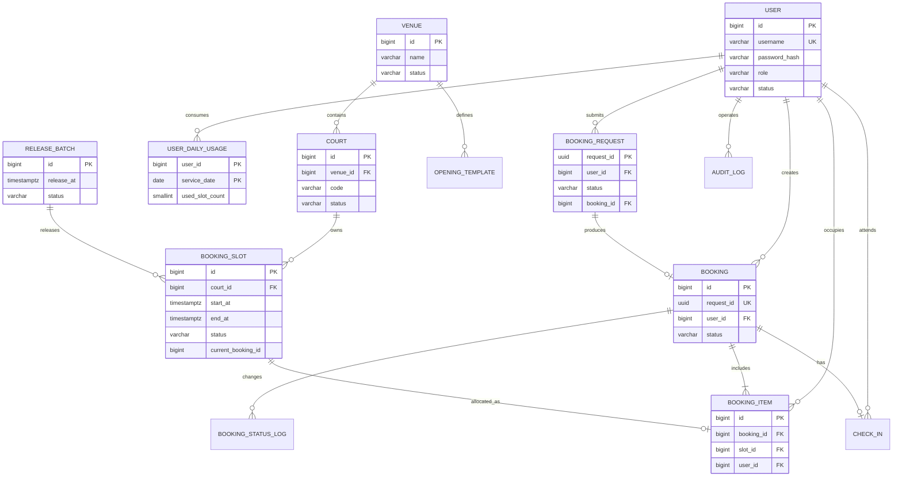

### 9.2 核心表结构

以下类型以 PostgreSQL 为准。所有表默认包含 `created_at timestamptz`、`updated_at timestamptz`；后台可修改表建议增加 `version int` 用于乐观锁。

#### user（用户）

| 字段 | 类型 | 约束/说明 |
|---|---|---|
| id | bigint | PK，雪花 ID 或数据库 identity |
| username | varchar(64) | UK，课程演示登录名 |
| password_hash | varchar(255) | Argon2 或 bcrypt 哈希，禁止保存明文密码 |
| student_no | varchar(32) | 学号，管理员账号可空 |
| display_name | varchar(64) | 姓名 |
| department | varchar(128) | 院系，可空 |
| role | varchar(24) | STUDENT / VENUE_ADMIN / PLATFORM_ADMIN |
| status | varchar(16) | ACTIVE / DISABLED / GRADUATED |
| last_login_at | timestamptz | 最近登录时间 |

索引：`unique(username)`、`unique(student_no)`、`index(status)`。

#### user_daily_usage（学生每日时段用量）

| 字段 | 类型 | 约束/说明 |
|---|---|---|
| user_id | bigint | PK，FK → user.id |
| service_date | date | PK，预约服务日期 |
| used_slot_count | smallint | 已确认时段数，只能为 0～2 |
| version | int | 并发更新版本 |

约束：`primary key(user_id, service_date)`、`check(used_slot_count between 0 and 2)`。Worker 在确认预约前通过 `SELECT ... FOR UPDATE` 锁定该行；不存在时先幂等插入 0，再加锁更新。由于预约不可取消，计数只增加不减少，从数据库层阻止同一学生通过并发请求突破每日两小时额度。

#### venue（场馆）

| 字段 | 类型 | 约束/说明 |
|---|---|---|
| id | bigint | PK |
| campus_code | varchar(32) | 校区编码 |
| name | varchar(128) | 场馆名称 |
| address | varchar(255) | 地址 |
| timezone | varchar(64) | 默认 `Asia/Shanghai` |
| status | varchar(16) | ACTIVE / CLOSED / MAINTENANCE |
| notice | text | 场馆公告 |

#### court（场地）

| 字段 | 类型 | 约束/说明 |
|---|---|---|
| id | bigint | PK |
| venue_id | bigint | FK → venue.id |
| code | varchar(32) | 场馆内编号 |
| name | varchar(64) | 展示名称 |
| sport_type | varchar(32) | 首期为 BADMINTON |
| status | varchar(16) | ACTIVE / DISABLED / MAINTENANCE |
| metadata | jsonb | 地板、灯光等扩展属性 |

约束：`unique(venue_id, code)`；索引：`index(venue_id, status)`。

#### opening_template（开放模板）

| 字段 | 类型 | 约束/说明 |
|---|---|---|
| id | bigint | PK |
| venue_id | bigint | FK → venue.id |
| name | varchar(64) | 模板名称 |
| weekday_mask | smallint | 周一至周日位图 |
| open_time | time | MVP 固定配置为 08:00 |
| close_time | time | MVP 固定配置为 22:00 |
| slot_minutes | smallint | MVP 固定配置为 60 |
| advance_days | smallint | MVP 固定配置为 2 |
| release_time | time | MVP 固定配置为 08:00 |
| valid_from/valid_to | date | 生效日期范围 |
| rule_json | jsonb | 身份、额度等扩展规则 |
| status | varchar(16) | DRAFT / ACTIVE / ARCHIVED |

#### calendar_exception（例外日）

| 字段 | 类型 | 约束/说明 |
|---|---|---|
| id | bigint | PK |
| venue_id | bigint | FK → venue.id |
| court_id | bigint | 可空；空表示全馆 |
| exception_date | date | 例外日期 |
| type | varchar(16) | CLOSED / CUSTOM_HOURS |
| custom_open_time/custom_close_time | time | 自定义时段，可空 |
| reason | varchar(255) | 原因 |

#### release_batch（放号批次）

| 字段 | 类型 | 约束/说明 |
|---|---|---|
| id | bigint | PK |
| venue_id | bigint | FK → venue.id |
| service_date | date | 被预约日期 |
| release_at | timestamptz | 放号时刻 |
| status | varchar(16) | DRAFT / READY / OPEN / PAUSED / CLOSED |
| slot_count | int | 本批次库存数 |
| rule_snapshot | jsonb | 放号时规则快照 |
| opened_at/closed_at | timestamptz | 实际开关时间 |

约束：`unique(venue_id, service_date, release_at)`；索引：`index(status, release_at)`。

#### booking_slot（库存时段）

| 字段 | 类型 | 约束/说明 |
|---|---|---|
| id | bigint | PK |
| court_id | bigint | FK → court.id |
| release_batch_id | bigint | FK → release_batch.id |
| service_date | date | 冗余日期，便于分区和查询 |
| start_at/end_at | timestamptz | 时段边界 |
| status | varchar(16) | UNRELEASED / AVAILABLE / BOOKED / BLOCKED |
| current_booking_id | bigint | FK → booking.id；BOOKED 时必填，其他状态为空 |
| block_reason | varchar(255) | 关闭原因，可空 |
| version | int | 乐观锁版本 |

约束：`unique(court_id, start_at, end_at)`、`check(start_at < end_at)`、`check((status = 'BOOKED') = (current_booking_id is not null))`；索引：`index(service_date, court_id, status)`、`index(release_batch_id, status)`。数据量较大时按 `service_date` 月度分区。

#### booking（预约主表）

| 字段 | 类型 | 约束/说明 |
|---|---|---|
| id | bigint | PK |
| request_id | uuid | UK，客户端请求幂等键 |
| booking_no | varchar(32) | UK，可读预约编号 |
| user_id | bigint | FK → user.id |
| venue_id | bigint | FK → venue.id，便于查询 |
| status | varchar(24) | PENDING / CONFIRMED / CHECKED_IN / COMPLETED / FAILED |
| rule_snapshot | jsonb | 下单时业务规则快照 |
| confirmed_at | timestamptz | 确认时间 |

索引：`unique(request_id)`、`unique(booking_no)`、`index(user_id, status, created_at desc)`、`index(venue_id, status, created_at)`。

#### booking_request（已受理请求结果）

| 字段 | 类型 | 约束/说明 |
|---|---|---|
| request_id | uuid | PK，全链路幂等键 |
| user_id | bigint | FK → user.id |
| release_batch_id | bigint | FK → release_batch.id |
| slot_ids | bigint[] | 请求的库存 ID 快照 |
| status | varchar(16) | PROCESSING / CONFIRMED / FAILED |
| booking_id | bigint | FK → booking.id，可空 |
| error_code | varchar(64) | 最终失败码，可空 |
| accepted_at/finished_at | timestamptz | 受理和完成时间 |

该表由 Worker 消费消息后幂等 upsert，不在流量入口同步写入，避免抢订瞬间直接冲击数据库。结果查询先查 Redis，缓存丢失或过期后回查本表；入口阶段直接拒绝的请求只记录聚合指标和采样日志，不逐条写数据库。

#### booking_item（预约明细）

| 字段 | 类型 | 约束/说明 |
|---|---|---|
| id | bigint | PK |
| booking_id | bigint | FK → booking.id |
| slot_id | bigint | FK → booking_slot.id |
| user_id | bigint | FK → user.id，为数据库时间冲突约束冗余保存 |
| service_date | date | 预约日期 |
| start_at/end_at | timestamptz | 预约时快照 |

约束：`unique(booking_id, slot_id)`、`unique(slot_id)`。预约确认后不可取消，库存不回流，因此 `unique(slot_id)` 可以作为数据库最终防超卖约束；即使 Redis 或 Worker 出现重复处理，同一库存也不可能进入第二个预约。

#### booking_status_log（预约状态历史）

| 字段 | 类型 | 约束/说明 |
|---|---|---|
| id | bigint | PK |
| booking_id | bigint | FK → booking.id |
| from_status/to_status | varchar(24) | 状态变更 |
| operator_type | varchar(16) | ADMIN / SYSTEM |
| operator_id | bigint | 可空 |
| reason | varchar(255) | 原因 |
| trace_id | varchar(64) | 关联链路 |

#### check_in（签到）

| 字段 | 类型 | 约束/说明 |
|---|---|---|
| id | bigint | PK |
| booking_id | bigint | UK，FK → booking.id |
| user_id | bigint | FK → user.id |
| method | varchar(16) | MVP 固定为 ADMIN |
| checked_in_at | timestamptz | 管理员确认到场的时间，不做预约时间窗校验 |
| verifier_id | bigint | 必填，FK → user.id，必须是管理员 |
| note | varchar(255) | 现场备注，可空 |

`unique(booking_id)` 保证重复点击只产生一条签到记录；管理员签到操作必须同时写入 `booking_status_log` 和 `audit_log`。

#### audit_log（审计日志）

| 字段 | 类型 | 约束/说明 |
|---|---|---|
| id | bigint | PK |
| actor_id | bigint | 操作者，可空 |
| actor_role | varchar(24) | 操作者角色 |
| action | varchar(64) | 操作类型 |
| resource_type/resource_id | varchar(32)/varchar(64) | 被操作资源 |
| before_data/after_data | jsonb | 变更前后，敏感字段脱敏 |
| ip | inet | 来源 IP |
| trace_id | varchar(64) | 链路 ID |

建议按月分区并设置不可由普通管理员删除的保留策略。

### 9.3 用户时间冲突约束

应用事务中必须检查学生已有预约是否与目标时段重叠。为强化数据库防线，`booking_item` 冗余保存 `user_id` 和时间范围，并使用 PostgreSQL 排他约束：

```sql
ALTER TABLE booking_item
ADD CONSTRAINT booking_item_user_time_excl
EXCLUDE USING gist (
  user_id WITH =,
  tstzrange(start_at, end_at, '[)') WITH &&
);
```

需要启用 `btree_gist` 扩展。`booking_item`、`booking_slot` 和 `user_daily_usage` 必须在同一事务写入：排他约束防止同一学生同时占用两个时间重叠的场地，`unique(slot_id)` 防止场地超卖，`used_slot_count ≤ 2` 防止每日超过两小时。

## 10. 用例设计

### 10.1 总体用例图

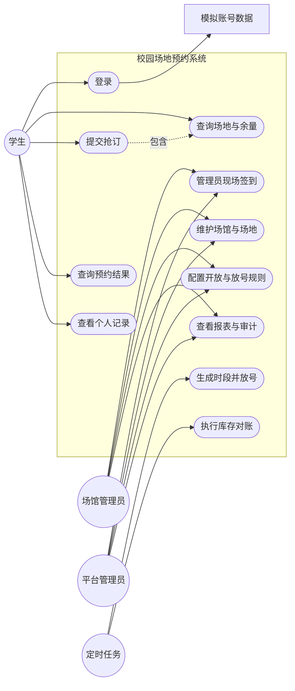

### 10.2 核心用例说明：提交抢订

| 项目 | 内容 |
|---|---|
| 用例编号 | UC-BOOK-01 |
| 参与者 | 已登录的学生 |
| 前置条件 | 批次已开放；目标时段存在；用户通过风控和基本额度校验 |
| 触发 | 用户确认场地和时段后点击“立即预约” |
| 主流程 | 客户端生成 request_id → 服务端校验 → Redis 原子占位 → 写入消息流 → 返回 PENDING → Worker 事务落库 → 用户查询最终结果 |
| 成功后置 | 预约为 CONFIRMED；库存为 BOOKED；每日用量和状态历史已写入 |
| 备选流程 | 未放号、无库存、超额度、时间冲突、重复请求、队列已满，返回稳定错误码和可读提示 |
| 一致性要求 | 同一 request_id 只有一个结果；一次选择的所有时段全成或全败；每日累计不超过 2 个时段；不得超卖 |

### 10.3 核心用例说明：管理员现场签到

| 项目 | 内容 |
|---|---|
| 用例编号 | UC-CHECKIN-01 |
| 参与者 | 场馆管理员、平台管理员 |
| 前置条件 | 管理员已登录并具备场馆管理权限；预约已确认且尚无签到记录 |
| 主流程 | 按预约编号、用户或场地检索 → 现场核对人员 → 点击确认签到 → 写入 check_in、状态历史和审计日志 |
| 时间规则 | 不限制签到时间，不需要学生端操作 |
| 备选流程 | 重复签到返回原结果；对已经结束的预约允许管理员补录到场记录 |
| 成功后置 | 未结束预约变为 CHECKED_IN；已结束预约保持 COMPLETED；两者都记录操作管理员和实际确认时间 |

## 11. 场景图与时序图

### 11.1 场景一：放号瞬间抢订成功

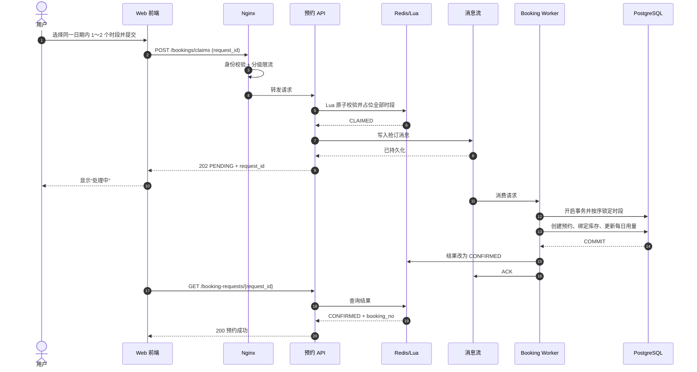

### 11.2 场景二：多人争抢同一时段

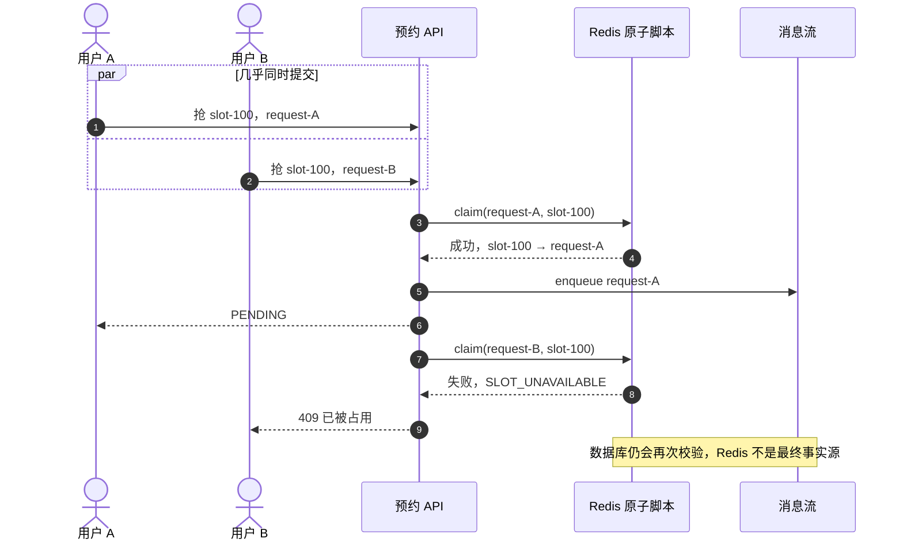

### 11.3 场景三：同一学生并发请求每日第三小时

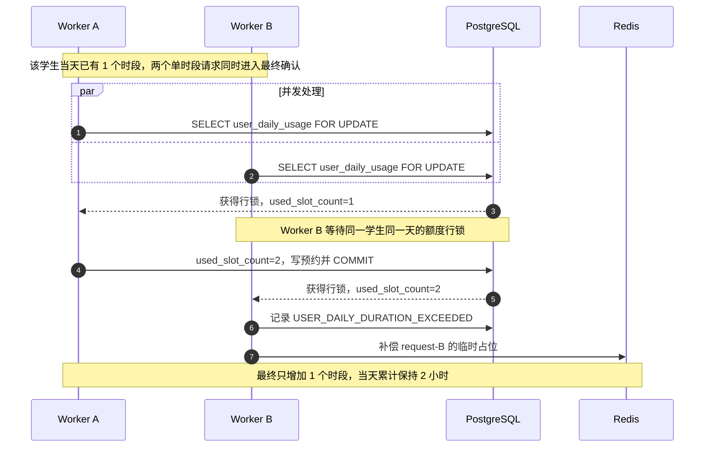

### 11.4 场景四：落库失败与补偿

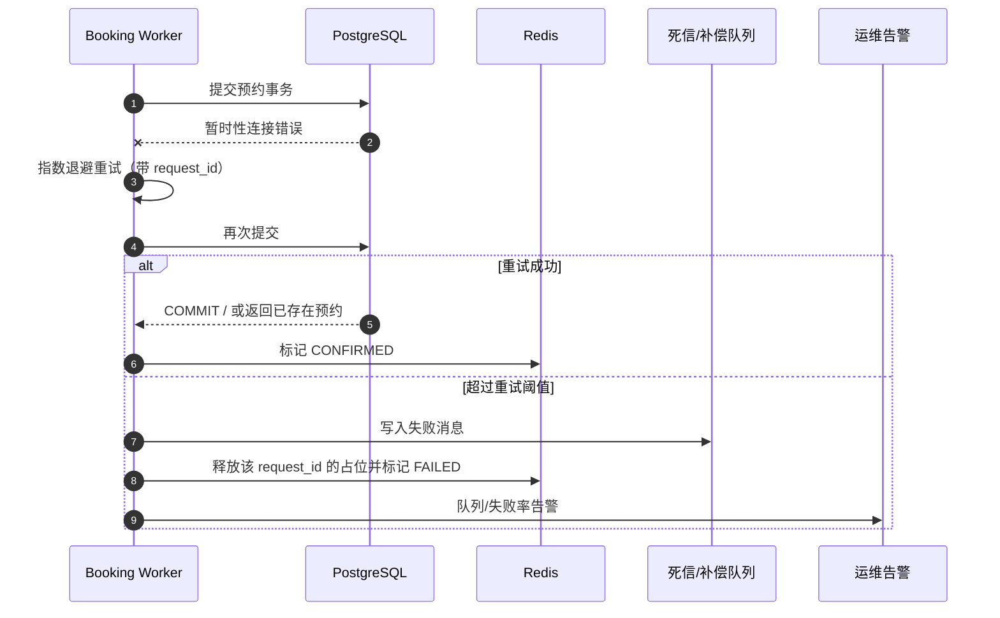

### 11.5 场景五：管理员现场签到

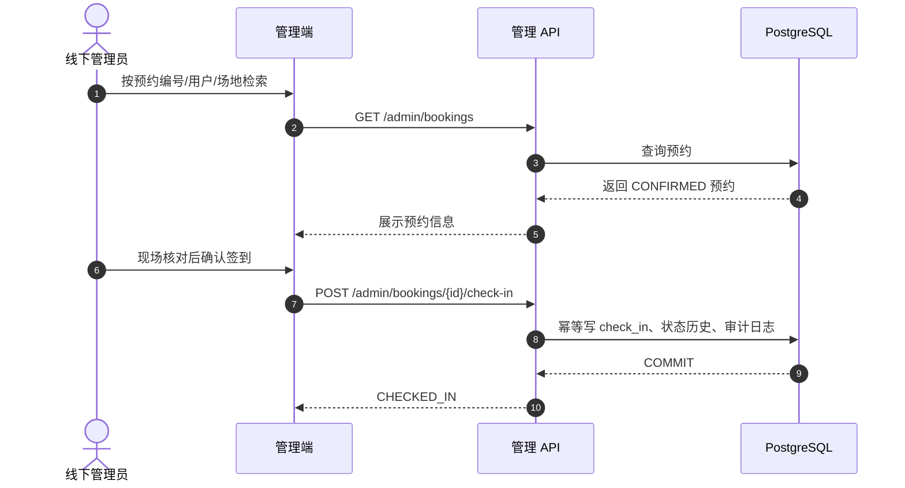

## 12. API 草案

统一前缀 `/api/v1`，响应携带 `trace_id`；写接口支持 `Idempotency-Key`，抢订接口请求体仍保留 `request_id` 便于全链路追踪。

### 12.1 用户端 API

| 方法与路径 | 功能 | 关键响应 |
|---|---|---|
| POST `/auth/login` | 模拟账号登录 | JWT、用户角色和基本资料 |
| GET `/auth/me` | 当前登录用户 | 学号、姓名和角色 |
| GET `/venues` | 场馆列表 | 场馆状态、公告 |
| GET `/venues/{venue_id}/availability?date=` | 日期余量 | 场地与各时段状态、缓存版本 |
| POST `/booking-requests` | 提交抢订 | `202 PENDING`、`request_id`，或稳定失败码 |
| GET `/booking-requests/{request_id}` | 查询处理结果 | PENDING / CONFIRMED / FAILED |
| GET `/bookings` | 我的预约 | 分页列表 |
| GET `/bookings/{booking_id}` | 预约详情 | 时段、状态、签到信息 |

抢订请求示例：

```json
{
  "request_id": "bc8d5f56-b5a7-42eb-a318-cf6e16804553",
  "release_batch_id": 2026082801,
  "slot_ids": [88001, 88002]
}
```

`slot_ids` 长度只能为 1 或 2，必须属于同一预约日期，可以不连续；服务端不能依赖前端完成此项校验。

失败码建议稳定枚举：`BATCH_NOT_OPEN`、`SLOT_UNAVAILABLE`、`USER_DAILY_DURATION_EXCEEDED`、`USER_TIME_CONFLICT`、`INVALID_SLOT_SELECTION`、`TOO_MANY_REQUESTS`、`QUEUE_FULL`、`SYSTEM_BUSY`。

### 12.2 管理端 API

| 方法与路径 | 功能 |
|---|---|
| PATCH `/admin/venue` | 维护唯一场馆资料和状态 |
| PATCH `/admin/courts/{id}` | 维护固定场地资料和启停状态 |
| POST/PATCH `/admin/opening-templates` | 开放模板维护 |
| POST `/admin/slot-generation-jobs` | 生成并预览时段 |
| POST `/admin/release-batches/{id}/open` | 手工放号 |
| POST `/admin/release-batches/{id}/pause` | 紧急暂停 |
| GET `/admin/bookings` | 按预约编号、用户、日期、场地检索现场预约 |
| POST `/admin/bookings/{id}/check-in` | 管理员现场签到，接口幂等且不限制时间窗 |
| GET `/admin/audit-logs` | 审计查询 |

## 13. 前端信息结构

### 13.1 用户端页面

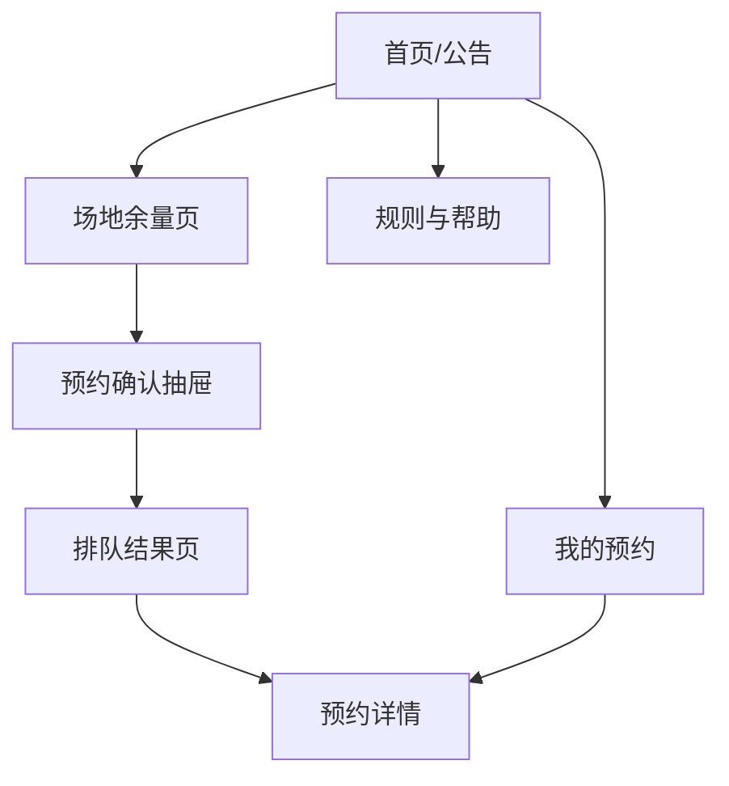

关键交互：前端倒计时在到点后必须向服务端重新获取批次状态；库存状态使用文字与图形共同表达；提交后按钮锁定并复用同一 `request_id`，网络重试不得创建新请求。

### 13.2 管理端页面

- 工作台：今日预约、待处理异常、现场签到入口、关键告警。
- 场馆与场地：基础资料、启停用、设施信息。
- 排期日历：开放模板、例外日、库存预览、放号批次。
- 预约管理：检索和管理员现场签到。
- 统计与审计：利用率、成功率、竞争冲突率、现场签到记录和操作审计。

## 14. 项目代码结构建议

目录同时体现“业务模块边界”和“MVC 分层”。每个领域模块内部使用相同的 `controllers → services/domain → repositories` 依赖方向，避免所有 Controller、Model 分散到全局大目录中。

```text
CampusReserve/
├─ apps/
│  ├─ api/                    # HTTP Controller 启动入口、中间件和路由注册
│  ├─ booking_worker/         # 异步 Controller：抢订消息消费者
│  └─ scheduler/              # 定时 Controller：时段生成、放号和对账入口
├─ src/campus_reserve/
│  ├─ auth/                   # 身份领域模块，结构同 bookings
│  ├─ users/                  # 用户领域模块，结构同 bookings
│  ├─ venues/                 # 场馆领域模块，结构同 bookings
│  ├─ inventory/              # 库存领域模块，结构同 bookings
│  ├─ bookings/
│  │  ├─ controllers/         # C：FastAPI Router、Worker Handler
│  │  │  ├─ http.py
│  │  │  └─ message.py
│  │  ├─ schemas/             # C：Pydantic 请求/响应 DTO
│  │  ├─ services/            # M：应用服务/用例编排
│  │  │  ├─ claim_booking.py
│  │  │  └─ confirm_booking.py
│  │  ├─ domain/              # M：纯 Python 业务模型
│  │  │  ├─ entities.py       # Booking、BookingSlot 等实体
│  │  │  ├─ value_objects.py
│  │  │  ├─ policies.py       # 每日两小时额度、时段选择与冲突规则
│  │  │  └─ events.py
│  │  ├─ repositories.py      # M：Repository/缓存/MQ 抽象接口
│  │  └─ infrastructure/      # Infrastructure：接口实现
│  │     ├─ sqlalchemy_repository.py
│  │     ├─ redis_claim_adapter.py
│  │     └─ message_queue_adapter.py
│  ├─ checkins/               # 管理员现场签到模块，结构同 bookings
│  ├─ admin/                  # 管理用例，不直接绕过领域模块
│  ├─ shared/
│  │  ├─ infrastructure/      # DB、Redis、MQ 连接与公共适配能力
│  │  ├─ errors.py
│  │  ├─ config.py
│  │  └─ observability.py
│  └─ domain_events/
├─ migrations/                # Alembic
├─ tests/
│  ├─ unit/
│  ├─ integration/
│  ├─ contract/
│  └─ load/
├─ web/                       # V：Vue 3 视图层
│  └─ src/
│     ├─ views/               # 页面级 View
│     ├─ components/          # 可复用 View 组件
│     ├─ stores/              # 前端展示状态
│     ├─ api/                 # Controller API 客户端
│     └─ router/
├─ deploy/
│  └─ compose/                # 单机课程演示环境
├─ docs/
└─ pyproject.toml
```

### 14.1 MVC 依赖约束

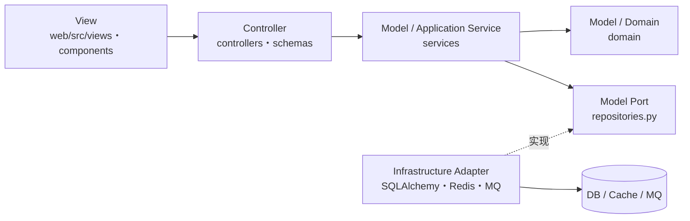

代码评审和自动化检查应执行以下约束：

1. View 只能通过 API Client 调用 Controller，不复制预约额度、放号和状态流转规则。
2. Controller 只能依赖 `schemas` 和 `services`，不得直接导入 SQLAlchemy Model、Redis Client 或消息队列 Client。
3. Application Service 负责编排用例和事务，Domain 保存可独立测试的实体、值对象和业务策略。
4. Domain 不依赖 FastAPI、SQLAlchemy、Redis Client 或 APScheduler；Repository 只定义抽象接口。
5. Infrastructure 实现 Repository/Port，并通过依赖注入装配；基础设施异常转换为统一应用错误。
6. HTTP Controller、Worker Controller 和 Scheduler Controller 必须复用相同的 Application Service。

### 14.2 一次预约请求的 MVC 调用示例

```text
BookingView.vue                                  # View：收集 slot_ids，展示 PENDING
  → POST /api/v1/booking-requests
bookings/controllers/http.py                    # Controller：鉴权、DTO 校验、响应转换
  → ClaimBookingService.execute(command)
bookings/services/claim_booking.py              # Model：编排额度、占位和入队用例
  → BookingPolicy / ClaimRepository / QueuePort
bookings/domain/policies.py                     # Model：预约规则
bookings/infrastructure/redis_claim_adapter.py  # Infrastructure：Redis Lua 原子占位
bookings/infrastructure/message_queue_adapter.py# Infrastructure：持久化抢订消息
  → Controller 返回 202 PENDING
```

这种结构显式保留 MVC，同时避免把高并发需要的 Redis、消息队列和异步 Worker 塞进 Controller。领域层不直接依赖 FastAPI、Redis 或 ORM，便于单元测试和未来拆分。

## 15. 测试与验收

### 15.1 功能与一致性测试

- 登录、权限边界、唯一场馆资料维护、固定场地资料维护和开放模板配置。
- 验证初始化数据恰好为 1 个场馆、15 片场地，每天 08:00—22:00 共生成 210 个 60 分钟库存时段。
- 验证每天 08:00 只开放未来第 2 天的库存。
- 时段跨日期和例外日期边界。
- 同一请求选择两个不连续时段时，两个时段全成功或全失败。
- 每名学生同一服务日期累计最多确认 2 个时段，可由一个双时段请求或两个单时段请求组成。
- 同一学生并发提交多个请求时，数据库 `user_daily_usage` 行锁保证最终累计不超过 2 个时段。
- 只有管理员可执行现场签到，签到不校验时间窗、允许结束后补录且重复提交幂等。
- 相同 `request_id` 并发提交 100 次只生成一个预约结果。
- 1,000 用户争抢同一时段最终只确认 1 单。
- 用户抢不同场地但时间重叠时最多确认 1 单。
- Worker 消费重复、乱序、崩溃重启后结果正确。
- 数据库事务成功但更新 Redis 失败，可由对账任务修复。

### 15.2 性能测试

使用 Locust（Python）模拟真实行为，而不是只压单个接口：登录态准备 → 放号前轮询 → 到点抢订 → 查询结果。至少覆盖：

| 场景 | 验收点 |
|---|---|
| 基线查询 | 1,000 RPS 下 P95 与错误率达标 |
| 热点放号 | 5,000 RPS 突发 30 秒，API 不崩溃、无超卖 |
| 极端同槽竞争 | 10,000 请求争 1 个时段，只确认 1 个 |
| 同一学生额度竞争 | 同一学生并发提交 100 个单时段请求，最终最多确认 2 个时段 |
| 15 片场地分散流量 | 验证热点分布和 Redis key 设计可承载固定场馆库存 |
| 队列堆积 | Worker 降速时入口能限流，延迟与告警符合阈值 |
| 故障注入 | Redis/DB/Worker 短暂故障后无脏单并能恢复 |

### 15.3 安全测试

- 越权访问其他用户预约、普通用户调用管理员现场签到接口。
- 重复提交管理员签到、伪造 request_id、篡改 slot_ids。
- 登录接口、查询接口、抢订接口的速率限制。
- XSS、SQL 注入、CSRF、敏感日志与导出文件泄露。
- 管理员高风险操作审计完整性。

## 16. 可观测性与课程演示

### 16.1 核心指标

- `booking_request_total{result, reason}`：受理/拒绝和原因。
- `booking_confirm_latency_seconds`：从受理到最终确认的耗时。
- `booking_queue_lag`、`booking_pending_count`：队列堆积。
- `slot_claim_conflict_total`：热点竞争程度。
- `booking_compensation_total{reason}`：补偿次数与原因。
- `inventory_reconciliation_mismatch_total`：对账差异。
- API RPS、P50/P95/P99、5xx、数据库连接池、Redis 延迟。

### 16.2 告警建议

- 5 分钟内确认失败率 > 2%。
- P99 确认耗时 > 10 秒或队列 lag 超阈值。
- 任意一次超卖/同一库存绑定异常，最高级别告警。
- 对账发现差异、死信队列有新增消息。
- 数据库连接池 > 80%、Redis 内存或延迟异常。

## 17. 迭代计划

按一名开发者全职投入估算，课程设计 MVP 用 10～12 周完成：

| 周次 | 主要任务 | 验收产物 |
|---|---|---|
| 第 1 周 | 冻结需求、页面草图、ER 与 MVC 目录 | 需求基线、架构图、可启动仓库 |
| 第 2 周 | Docker Compose、FastAPI、Vue、PostgreSQL、Redis 工程底座 | 一键启动；模拟学生/管理员登录；Alembic 迁移 |
| 第 3 周 | 场馆、15 片场地、开放模板、时段生成和 08:00 放号 | 210 个日库存可重复生成且不重复 |
| 第 4 周 | 库存查询、预约页面、管理端基础页面 | 可查询未来第 2 天并选择 1～2 个时段 |
| 第 5 周 | Redis Lua 原子占位、幂等和基础限流 | 两个不连续时段全成或全败 |
| 第 6 周 | Redis Streams、Booking Worker、数据库最终确认 | API 返回 PENDING，Worker 异步确认结果 |
| 第 7 周 | 每日两小时额度、时间冲突、失败补偿和对账 | 并发请求不能突破 2 小时，失败占位可恢复 |
| 第 8 周 | 我的预约、管理员现场签到、审计 | MVP 功能链路完整 |
| 第 9 周 | 单元/集成测试、前后端联调和异常提示 | 核心自动化测试通过 |
| 第 10 周 | Locust 压测、热点库存竞争和性能优化 | 5,000 RPS 测试报告、0 超卖证据 |
| 第 11 周 | Worker 重启、重复消息和数据库/Redis 异常演练 | 幂等、补偿、队列恢复演示 |
| 第 12 周 | 缓冲、课程报告、答辩 PPT 和演示脚本 | 可复现演示环境和课程设计材料 |

## 18. 关键风险与决策

| 风险/决策 | 建议 |
|---|---|
| 把 Redis 占位直接视为成功 | 禁止；必须等待数据库最终确认 |
| 使用分布式锁包住整个预约流程 | 不建议；锁粒度与故障恢复复杂，使用原子脚本 + 队列 + DB 约束 |
| 客户端显示 08:00 就直接认为已放号 | 禁止；始终以服务端批次状态和 `Asia/Shanghai` 服务器时间为准 |
| 过早微服务化 | 首期采用模块化单体 + 独立 Worker，降低事务与运维复杂度 |
| 所有请求都访问数据库查额度 | 峰时会放大压力；Redis 粗校验，数据库事务精确校验 |
| 只做平均性能测试 | 必须测试放号瞬间突发、同一热点时段和依赖故障 |
| “先到先得”定义不清 | 产品文档应明确是“服务端成功占位顺序”，不是客户端点击时间 |

## 19. 已冻结参数与课程演示数据

### 19.1 已冻结、开发时不再等待确认

- 用户范围：学生。
- 资源范围：1 个场馆、15 片羽毛球场。
- 每日 08:00—22:00 开放，每个时段 60 分钟。
- 每天 08:00 开放未来第 2 天库存。
- 单次可选同一日期内 1～2 个时段，时段可以不连续。
- 每名学生每天累计最多确认 2 个时段，可以分多次提交。
- 预约一经确认即保持有效，库存不回流。
- 现场签到由线下管理员完成，不设置签到时间窗。
- 容量按 10,000 人同时抢订、峰值 5,000 RPS、0 超卖验收。

### 19.2 默认种子数据

1. 场馆名称使用“校园羽毛球馆”，场地编号为 `COURT-01`～`COURT-15`。
2. 预置普通学生、场馆管理员和平台管理员演示账号，密码哈希后保存。
3. 功能演示使用固定账号；Locust 压测在准备阶段批量生成学生测试数据和访问令牌。
4. 数据库初始化时生成开放模板、未来日期库存和一个可立即放号的测试批次。
5. 所有演示数据可通过 Docker Compose 初始化命令重复重建。

## 20. 推荐的下一步

1. 依据第 1.4 节创建 MVP 配置和种子数据：1 个场馆、15 片场地、08:00—22:00 开放模板。
2. 按 10,000 人同时抢订和 5,000 RPS 建立 Locust 容量模型。
3. 先实现“单场地、单时段”的垂直切片，完成并发一致性验证后扩展到 15 片场地和同日 2 个不连续时段的原子预约。
4. 输出 OpenAPI、数据库迁移初稿、Redis key 规范和 Lua 占位脚本评审稿。
5. 在第 5～7 周先完成一次 10,000 请求争抢单库存的技术验证，确认 0 超卖与故障补偿路径，再继续完善页面。
