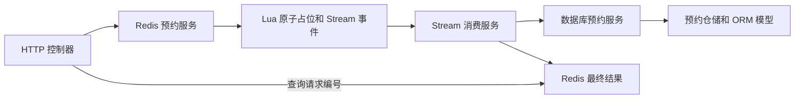

# `src` 目录代码详解

> 本文对应当前 `src/campus_reserve` 源码，适合按文件阅读和答辩时定位修改点。进程如何启动见 [`apps` 目录三个进程入口详解](apps目录三个进程入口详解.md)，页面代码见 [`web` 目录代码详解](web目录代码详解.md)。

## 1. `src` 在项目中的位置

`src/campus_reserve` 是三个后端进程共用的 Python 包：API 进程调用其中的 HTTP 控制器，Worker 调用预约处理服务，Scheduler 调用库存和预约归档服务。代码大致按以下方向依赖：

```text
controllers/http.py  接收请求、鉴权、把结果变成 HTTP 响应
        ↓
schemas.py           定义请求和响应的数据形状
        ↓
services/            执行业务规则和流程
        ↓
repositories.py      声明服务需要哪些数据操作
        ↓
infrastructure/      用 SQLAlchemy、Redis 或 Lua 实现数据操作
        ↓
models.py            定义 PostgreSQL 表、关联和约束
```

这是一种阅读顺序，不表示所有功能都严格逐层调用。例如，HTTP 控制器可以直接通过仓储查展示数据；Redis 预约服务会运行 Lua 脚本。`src/campus_reserve.egg-info/` 是 Python 安装产生的包元数据，不属于手写业务源码。

### 关键名词

| 名词 | 含义 |
| --- | --- |
| `service_date` | 场地**使用日期**，不是提交预约的日期。 |
| `release_batch` | 某个场馆、某个使用日期的一批库存，带放号时间和批次状态。 |
| `booking_slot` | 一片场地在一个具体时间段的库存记录。 |
| `request_id` | 提交前生成的 UUID，用于幂等重试和异步结果找回。 |
| `booking_no` | 预约确认后生成的业务编号。 |
| `PROCESSING` | Redis 已受理请求，Worker 尚未给出最终数据库结果。 |

## 2. 根包与共享基础设施

| 文件 | 作用与阅读重点 |
| --- | --- |
| [`campus_reserve/__init__.py`](../src/campus_reserve/__init__.py) | Python 主包标记；主要帮助模块按 `campus_reserve.*` 路径导入。 |
| [`campus_reserve/models.py`](../src/campus_reserve/models.py) | 集中导入各业务模块的 ORM 模型，使 SQLAlchemy 元数据和 Alembic 迁移能发现所有表；新增模型时应检查这里。 |
| [`shared/__init__.py`](../src/campus_reserve/shared/__init__.py) | 共享模块的包标记。 |
| [`shared/config.py`](../src/campus_reserve/shared/config.py) | `Settings` 从环境变量读取数据库、Redis、JWT、Stream、时区、日志等配置；`get_settings()` 缓存配置对象。新增环境变量要同时更新配置样例和部署设置。 |
| [`shared/database.py`](../src/campus_reserve/shared/database.py) | 定义 ORM `Base`、公共时间戳、异步数据库引擎及会话工厂，还提供连接检查和关闭函数。数据库操作通常通过这里创建的 `AsyncSession` 完成。 |
| [`shared/enums.py`](../src/campus_reserve/shared/enums.py) | 定义用户角色、场馆、场地、批次、时段、预约、请求、签到等状态枚举，并把字符串枚举与数据库字段衔接。修改状态会连带影响模型、接口和前端。 |
| [`shared/logging.py`](../src/campus_reserve/shared/logging.py) | 初始化结构化 JSON 日志；API、Worker、Scheduler 都使用它，方便按事件名排查问题。 |
| [`shared/metrics.py`](../src/campus_reserve/shared/metrics.py) | Prometheus HTTP 请求指标中间件和 `/metrics` 输出；展示请求量、时延等 API 指标时从这里查。 |
| [`shared/redis.py`](../src/campus_reserve/shared/redis.py) | 创建、共享和关闭异步 Redis 客户端；三个进程都通过它访问 Redis。 |

**阅读提示：** `database.py` 负责“怎样连接数据库”，`models.py` 负责“有哪些 ORM 表”，各业务目录的 `models.py` 才负责“每张表有哪些字段和约束”。

## 3. 用户、场馆、签到三个基础领域

| 文件 | 作用与阅读重点 |
| --- | --- |
| [`users/__init__.py`](../src/campus_reserve/users/__init__.py) | 用户模块包标记。 |
| [`users/models.py`](../src/campus_reserve/users/models.py) | `User` 保存账号、角色、启用状态等；`UserDailyUsage` 保存用户在某个使用日期的累计时段用量，是每日额度的数据库记录。修改用户字段或额度约束时，模型与新迁移必须同步。 |
| [`venues/__init__.py`](../src/campus_reserve/venues/__init__.py) | 场馆模块包标记。 |
| [`venues/models.py`](../src/campus_reserve/venues/models.py) | `Venue`、`Court`、`OpeningTemplate`、`CalendarException` 四类表。它们分别描述场馆、场地、长期开放模板和特定日期的例外；星期掩码及模板生效日期在这里定义。 |
| [`checkins/__init__.py`](../src/campus_reserve/checkins/__init__.py) | 签到模块包标记。 |
| [`checkins/models.py`](../src/campus_reserve/checkins/models.py) | `CheckIn` 表和预约的签到记录关系；执行签到、校验状态、写审计的业务逻辑位于管理服务。 |

## 4. `auth`：登录与身份验证

调用链：`auth/controllers/http.py` → `auth/services/authenticate.py` → `auth/repositories.py` / SQLAlchemy 实现；令牌签发和校验由 `auth/security.py` 负责。

| 文件 | 作用与阅读重点 |
| --- | --- |
| [`auth/__init__.py`](../src/campus_reserve/auth/__init__.py) | 认证模块包标记。 |
| [`auth/controllers/__init__.py`](../src/campus_reserve/auth/controllers/__init__.py) | 认证控制器子包标记。 |
| [`auth/controllers/http.py`](../src/campus_reserve/auth/controllers/http.py) | `/login` 接收账号密码并返回令牌，`/me` 返回当前用户资料；把认证失败转换为 HTTP 错误。增加登录接口或调整响应入口从这里找。 |
| [`auth/dependencies.py`](../src/campus_reserve/auth/dependencies.py) | FastAPI 的 `CurrentPrincipal` 依赖：读取 Bearer Token、解析 JWT，供需要登录的路由复用。改鉴权入口或令牌校验时查这里。 |
| [`auth/infrastructure/__init__.py`](../src/campus_reserve/auth/infrastructure/__init__.py) | 认证持久化实现子包标记。 |
| [`auth/infrastructure/sqlalchemy_repository.py`](../src/campus_reserve/auth/infrastructure/sqlalchemy_repository.py) | `SqlAlchemyUserRepository` 用 SQLAlchemy 按用户名或 ID 查询用户，并记录登录信息。 |
| [`auth/repositories.py`](../src/campus_reserve/auth/repositories.py) | `UserRepository` 协议：规定认证服务需要的查询和记录登录方法，避免服务直接绑定 SQLAlchemy。 |
| [`auth/schemas.py`](../src/campus_reserve/auth/schemas.py) | 登录请求、令牌响应和用户资料的 Pydantic 模型；接口字段变化通常先检查它。 |
| [`auth/security.py`](../src/campus_reserve/auth/security.py) | Argon2 密码验证、JWT 签发与解析、令牌中的用户身份数据；令牌有效期还受 `shared/config.py` 配置影响。 |
| [`auth/services/__init__.py`](../src/campus_reserve/auth/services/__init__.py) | 认证服务子包标记。 |
| [`auth/services/authenticate.py`](../src/campus_reserve/auth/services/authenticate.py) | `AuthService` 校验账号、密码和用户启用状态，并可根据 ID 读取当前有效用户。 |

**注意：** 页面隐藏管理员按钮只改善体验，真正的身份和角色限制仍在后端依赖及路由中执行。

## 5. `inventory`：库存生成、放号与查询

库存由开放模板、场地状态、例外日期和放号规则生成。PostgreSQL 保存日期批次及时段结构；开放批次的实时预占状态还会叠加 Redis 数据。Scheduler 定期调用这里的服务补齐今天和目标开放日期。

| 文件 | 作用与阅读重点 |
| --- | --- |
| [`inventory/__init__.py`](../src/campus_reserve/inventory/__init__.py) | 库存模块包标记。 |
| [`inventory/controllers/__init__.py`](../src/campus_reserve/inventory/controllers/__init__.py) | 库存控制器子包标记。 |
| [`inventory/controllers/http.py`](../src/campus_reserve/inventory/controllers/http.py) | 场馆列表和指定日期库存接口；读取批次、场地、时段并结合 Redis 状态，生成页面使用的 `AVAILABLE`、`PROCESSING`、`BOOKED`、`EXPIRED` 等展示状态。改接口返回或状态优先级先看这里。 |
| [`inventory/infrastructure/__init__.py`](../src/campus_reserve/inventory/infrastructure/__init__.py) | 库存数据库实现子包标记。 |
| [`inventory/infrastructure/sqlalchemy_repository.py`](../src/campus_reserve/inventory/infrastructure/sqlalchemy_repository.py) | `SqlAlchemyInventoryRepository` 查询模板、例外、场地、批次和时段；写入批次/时段，并使用 PostgreSQL advisory lock 保护同一日期的并发生成。 |
| [`inventory/models.py`](../src/campus_reserve/inventory/models.py) | `ReleaseBatch` 保存使用日期、放号时间和批次状态；`BookingSlot` 保存场地、开始结束时间和库存状态。对应唯一约束防止同一场地时段被重复生成。 |
| [`inventory/repositories.py`](../src/campus_reserve/inventory/repositories.py) | `InventoryRepository` 协议和库存查询行类型，列出库存服务所需的数据操作。 |
| [`inventory/schemas.py`](../src/campus_reserve/inventory/schemas.py) | 场馆摘要、场地摘要、时段和整日库存等 Pydantic 响应模型。新增页面需要的库存字段时要看它。 |
| [`inventory/services/__init__.py`](../src/campus_reserve/inventory/services/__init__.py) | 库存服务子包标记。 |
| [`inventory/services/inventory.py`](../src/campus_reserve/inventory/services/inventory.py) | `build_slot_windows()` 按开放时间划分时段；`InventoryService.synchronize_target()` 依据星期掩码、例外日、提前天数和放号时间生成或复用批次，并在条件满足时开放；还提供场馆列表和库存读取。 |

### 库存生成的关键判断

1. `service_date` 是场地实际使用日；提前天数决定何时放号。
2. 模板的星期掩码决定某一天是否适用，例如七位全部为 1 时为 `127`。
3. 例外日期可以关闭全馆或单片场地，也可以调整开放时间。
4. 已生成的批次应复用，避免调度器重复运行导致重复库存。
5. 今天已经开始的时段仍可展示，但不能再作为可预约库存。

## 6. `bookings`：预约的完整处理链



**先在 Redis 防止同一库存被同时抢占，再在数据库事务中做最终确认。** 所以 API 返回 `PROCESSING` 时，尚不能把它当成正式预约成功。

| 文件 | 作用与阅读重点 |
| --- | --- |
| [`bookings/__init__.py`](../src/campus_reserve/bookings/__init__.py) | 预约模块包标记。 |
| [`bookings/controllers/__init__.py`](../src/campus_reserve/bookings/controllers/__init__.py) | 预约控制器子包标记。 |
| [`bookings/controllers/http.py`](../src/campus_reserve/bookings/controllers/http.py) | `POST /booking-requests` 提交请求，`GET /booking-requests/{request_id}` 找回结果，`GET /bookings` 和 `GET /bookings/{booking_id}` 查个人预约；检查学生身份并把服务结果转成响应和错误码。 |
| [`bookings/infrastructure/__init__.py`](../src/campus_reserve/bookings/infrastructure/__init__.py) | 预约基础设施子包标记。 |
| [`bookings/infrastructure/sqlalchemy_repository.py`](../src/campus_reserve/bookings/infrastructure/sqlalchemy_repository.py) | `SqlAlchemyBookingRepository` 实现数据库事务所需的请求锁、用户日期锁、库存加锁查询、每日用量查询及预约/明细/日志写入。 |
| [`bookings/infrastructure/lua/initialize_inventory.lua`](../src/campus_reserve/bookings/infrastructure/lua/initialize_inventory.lua) | 在 Redis 中原子初始化一个开放批次的时段状态及已确认用户用量；支持重复调用时避免覆盖已有占位。 |
| [`bookings/infrastructure/lua/reserve_slots.lua`](../src/campus_reserve/bookings/infrastructure/lua/reserve_slots.lua) | 原子检查请求幂等、批次状态、时段可用性和每日额度；成功后占位，并把事件写入 Redis Stream。高并发防重复抢同一时段的关键脚本。 |
| [`bookings/infrastructure/lua/compensate_reservation.lua`](../src/campus_reserve/bookings/infrastructure/lua/compensate_reservation.lua) | Worker 确认数据库处理失败后，只释放仍属于该请求的 Redis 占位并回退对应额度，避免误释放别人的库存。 |
| [`bookings/models.py`](../src/campus_reserve/bookings/models.py) | `BookingRequest`、`Booking`、`BookingItem`、`BookingStatusLog` 四类表；分别保存请求与状态、正式预约、预约时段明细、状态变化历史。唯一约束是防重复预约的数据库保障之一。 |
| [`bookings/repositories.py`](../src/campus_reserve/bookings/repositories.py) | `BookingRepository` 协议，规定数据库预约服务需要的锁、查询和写入动作。 |
| [`bookings/schemas.py`](../src/campus_reserve/bookings/schemas.py) | 提交预约、查询请求结果、正式预约及其明细的 Pydantic 数据结构。接口字段增减通常要同步修改它和前端类型。 |
| [`bookings/services/__init__.py`](../src/campus_reserve/bookings/services/__init__.py) | 预约服务子包标记。 |
| [`bookings/services/redis_reservation.py`](../src/campus_reserve/bookings/services/redis_reservation.py) | 定义 Redis 键、命令和结果对象；加载并调用三个 Lua 脚本，提供库存初始化、原子预占和失败补偿的方法。 |
| [`bookings/services/stream_booking.py`](../src/campus_reserve/bookings/services/stream_booking.py) | 解析 Stream 事件，调用数据库服务，写回最终结果并确认消息；包含重领、重试上限、死信和对账/补偿逻辑，是 Worker 的主要业务实现。 |
| [`bookings/services/sync_booking.py`](../src/campus_reserve/bookings/services/sync_booking.py) | `SyncBookingService.submit()` 在数据库事务中再次校验日期、批次、时段、每日额度与幂等性；确认后写入请求、预约、明细、每日用量和状态日志。虽名为 `sync`，实际使用异步数据库调用；这里的“同步”是相对 Redis Stream 的异步链路而言。 |

### 两种编号不要混淆

- `request_id` 在提交请求**之前**由客户端生成。网络超时后仍可用它继续查询，重试相同操作也靠它识别。
- `booking_no` 在数据库确认成功**之后**才生成，用于学生查看和管理员现场检索。它所带的日期表示使用日期。

## 7. `admin`：管理闭环与审计

管理端操作由后端角色校验。场馆、场地、模板和例外日期决定未来库存；批次操作控制放号；预约查询和签到处理到场业务；审计日志记录关键管理操作。

| 文件 | 作用与阅读重点 |
| --- | --- |
| [`admin/__init__.py`](../src/campus_reserve/admin/__init__.py) | 管理模块包标记。 |
| [`admin/controllers/__init__.py`](../src/campus_reserve/admin/controllers/__init__.py) | 管理控制器子包标记。 |
| [`admin/controllers/http.py`](../src/campus_reserve/admin/controllers/http.py) | 注册管理总览、场馆/场地、开放模板、例外日期、库存生成、批次操作、预约搜索、签到和审计接口；在路由层执行角色限制、依赖注入与错误转换。 |
| [`admin/models.py`](../src/campus_reserve/admin/models.py) | `AuditLog` 表，保存操作人、操作类型、资源标识、前后数据及追踪信息。 |
| [`admin/schemas.py`](../src/campus_reserve/admin/schemas.py) | 管理接口的输入与输出模型；包含场馆/场地修改、模板、例外日期、生成预览、批次、签到、审计等结构及字段验证。 |
| [`admin/services.py`](../src/campus_reserve/admin/services.py) | `AdminService` 实现配置维护、批次生成/发布/暂停/恢复/关闭、Redis 状态同步、预约搜索、签到和审计；`archive_completed_bookings()` 供 Scheduler 把已结束预约更新为完成状态。 |

改“管理按钮能否点击”要同时核对：页面的显隐、`admin/controllers/http.py` 的角色限制、`admin/services.py` 的业务规则及 Redis 批次门控。只改页面文字不会改变实际开放状态。

## 8. `system`：服务健康状态

| 文件 | 作用与阅读重点 |
| --- | --- |
| [`system/__init__.py`](../src/campus_reserve/system/__init__.py) | 系统模块包标记。 |
| [`system/controllers/__init__.py`](../src/campus_reserve/system/controllers/__init__.py) | 系统控制器子包标记。 |
| [`system/controllers/http.py`](../src/campus_reserve/system/controllers/http.py) | `/health/live` 表示 API 进程存活；`/health` 查询依赖就绪情况，供页面和容器健康检查使用。 |
| [`system/schemas/__init__.py`](../src/campus_reserve/system/schemas/__init__.py) | 健康响应模型子包标记。 |
| [`system/schemas/health.py`](../src/campus_reserve/system/schemas/health.py) | 数据库、Redis 组件状态及整体健康响应的数据结构。 |
| [`system/services/__init__.py`](../src/campus_reserve/system/services/__init__.py) | 系统服务子包标记。 |
| [`system/services/health.py`](../src/campus_reserve/system/services/health.py) | 实际探测 PostgreSQL 和 Redis，汇总 API 的就绪状态。Worker 和 Scheduler 自己的健康状态由其心跳与 Compose 健康检查监控。 |

## 9. 现场修改速查

| 老师提出的变更 | 建议先读 | 还需要同步检查 |
| --- | --- | --- |
| 增加登录返回字段 | `auth/schemas.py`、`auth/controllers/http.py` | `web/src/App.vue` 的 TypeScript 类型 |
| 修改令牌有效期或角色规则 | `shared/config.py`、`auth/security.py`、`auth/dependencies.py` | 管理和预约路由中的角色校验 |
| 修改场地开放星期或放号时间 | `venues/models.py`、`inventory/services/inventory.py` | 管理服务、现有批次、新迁移、页面文案 |
| 修改“已预约/已过期”等展示 | `inventory/controllers/http.py` | `inventory/schemas.py`、`web/src/App.vue` |
| 修改单次或每日预约额度 | `bookings/services/redis_reservation.py`、`reserve_slots.lua`、`sync_booking.py` | `users/models.py`、数据库约束、新迁移、页面限制、测试 |
| 修改同一时段的场地冲突规则 | `reserve_slots.lua`、`sync_booking.py` | `bookings/models.py` 的唯一约束和相关迁移 |
| 修改管理端批次操作 | `admin/controllers/http.py`、`admin/services.py` | Redis 批次门控、`web/src/AdminPanel.vue` |
| 增加数据库字段 | 对应 `models.py`、`schemas.py`、仓储 | 新 Alembic 迁移、接口、前端、测试 |

修改表结构时应**新增迁移文件**，不要只改模型，也不要通过改已经执行过的历史迁移来期望现有数据库自动变化。

## 10. 推荐阅读顺序

1. 从 [`bookings/controllers/http.py`](../src/campus_reserve/bookings/controllers/http.py) 看学生提交和查询了哪些接口。
2. 读 [`bookings/services/redis_reservation.py`](../src/campus_reserve/bookings/services/redis_reservation.py) 与三个 Lua 脚本，理解预占如何防冲突。
3. 读 [`bookings/services/stream_booking.py`](../src/campus_reserve/bookings/services/stream_booking.py) 和 [`bookings/services/sync_booking.py`](../src/campus_reserve/bookings/services/sync_booking.py)，理解最终确认、失败和找回。
4. 读 [`inventory/services/inventory.py`](../src/campus_reserve/inventory/services/inventory.py) 与 [`inventory/controllers/http.py`](../src/campus_reserve/inventory/controllers/http.py)，理解库存如何生成及展示。
5. 最后读 [`admin/services.py`](../src/campus_reserve/admin/services.py)，把配置、放号、签到、审计与归档串成管理闭环。
