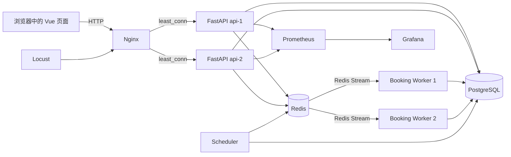

# CampusReserve 两周项目学习计划（零基础版）

> 适用项目：校园羽毛球场高并发预约系统
> 建议投入：连续 14 天，每天约 4 小时，总计约 56 小时
> 最终目标：达到“课程答辩级掌握”——能从前端点击一路讲到 Redis、Worker 和 PostgreSQL，能说明关键业务规则为什么不会超卖，并能在现场独立完成常见的小功能修改。

## 1. 两周后怎样算“弄懂了”

“弄懂”不是背下每一行代码，而是能够做到下面六件事：

- 不看文档画出系统架构，说明每个容器和主要目录的职责。
- 从任意一个接口出发，准确说出 Controller、Schema、Service、Repository、数据库或 Redis 的调用路径。
- 解释登录、库存生成、预约抢占、异步落库、失败补偿五条核心流程。
- 解释系统怎样依靠 Redis Lua、幂等键、数据库事务和唯一约束实现“0 超卖”。
- 看懂测试失败信息，能定位到对应的业务层，并完成小范围修改。
- 清楚区分“需求文档规划的功能”和“当前代码已经实现的功能”。

当前项目仍是课程设计 MVP。学生登录、库存、抢票、异步落库等主链路已经实现；管理端完整页面、签到接口、对账和状态归档等内容还没有全部实现。答辩时不要把规划文档里的未来功能说成已经完成。

## 2. 项目全景图



### 三条必须背熟的调用链

```text
登录：
App.vue → Nginx → auth/controller → AuthService → UserRepository → PostgreSQL

查看库存：
App.vue → inventory/controller → InventoryService → InventoryRepository → PostgreSQL

预约抢票：
App.vue → booking/controller → Redis Lua 原子占位 → Redis Stream
        → Booking Worker → SyncBookingService → PostgreSQL
        → Redis 保存最终结果 → App.vue 轮询得到结果
```

## 3. 每天固定采用的学习方法

每天按下面的节奏执行，不建议只看代码不动手：

| 阶段 | 时间 | 做什么 |
|---|---:|---|
| 复习 | 20 分钟 | 不看资料，口述昨天学到的调用链和关键词 |
| 补基础 | 40 分钟 | 学当天代码需要的最少语法或概念 |
| 读代码 | 90 分钟 | 按本计划给出的顺序阅读，不懂的符号逐个查 |
| 动手验证 | 70 分钟 | 启动、调用接口、看日志、跑测试或做小修改 |
| 输出总结 | 40 分钟 | 画图、写笔记，并用自己的话“讲给老师听” |

阅读每个文件时，都回答以下五个问题：

1. 谁会调用这个文件或函数？
2. 它又调用了谁？
3. 输入和输出分别是什么？
4. 它修改了 PostgreSQL、Redis、浏览器状态中的哪一种？
5. 执行失败后会怎样处理？

建议为每个重要函数做一张“函数卡片”：

```text
函数名：
所在文件：
调用者：
参数：
返回值：
正常路径：
异常路径：
修改的数据：
对应测试：
```

## 4. 开始前的安全约定

- 每天修改前先执行 `git status --short`，确认哪些改动是自己的。
- 学习性修改尽量建一个练习分支，例如 `git switch -c study/two-week-plan`。
- 每次只改一个点，改前记录原值，改后先看 `git diff` 再测试。
- 不要用 `git reset --hard` 或 `git checkout --` 清理不明改动。
- `docker compose down` 会停止容器但保留数据。
- `docker compose down -v` 会删除 PostgreSQL、Redis、Prometheus 和 Grafana 数据卷，除非明确需要重置演示数据，否则不要执行。

---

## 第 1 天：从用户视角认识系统并成功运行

### 今日目标

先知道“这个系统解决什么问题”，再认识技术名词。今天不钻进复杂的预约代码。

### 阅读顺序

1. `README.md`
2. `docs/project-plan.md` 中的项目概述、业务规则、系统结构和测试验收部分
3. `compose.yaml`
4. `.env.example`（如果本地存在）

### 必须理解

- 系统角色：学生、场馆管理员、平台管理员、定时任务。
- 固定规则：1 个场馆、15 片场地、08:00—22:00、每天最多 2 小时、提前 2 天放票。
- “请求受理”与“预约最终成功”不是一回事。
- PostgreSQL 保存最终可信数据；Redis 承担热点库存、原子抢占、临时结果和消息流。
- Compose 中每个服务的用途及依赖关系。

### 动手任务

```powershell
docker compose up -d --build
docker compose ps
docker compose logs --tail=80 api-1 booking-worker-1 scheduler
Invoke-RestMethod http://localhost:8080/api/v1/system/health
```

在浏览器完成一次：登录 → 查看库存 → 选择时段 → 提交预约 → 查看“我的预约”。同时打开浏览器开发者工具的 Network 面板，记录出现的接口。

### 当日产物

- 一张“容器名称—作用—端口—依赖”的表。
- 用 200 字说明为什么系统不能只使用 PostgreSQL 直接抢票。
- 能在 3 分钟内向别人介绍这个项目。

### 自测问题

- 为什么有两个 API 和两个 Worker，却通常只有一个 Scheduler？
- `depends_on` 和 `healthcheck` 各解决什么问题？
- 为什么浏览器访问的是 8080，而 API 容器监听的是 8000？

---

## 第 2 天：Python 异步基础、公共设施和三个程序入口

### 今日目标

理解项目怎样启动，以及所有业务模块共同使用哪些基础能力。

### 补基础

- Python 模块、包和 `__init__.py`
- 类型标注、`dataclass`、`Enum`、`Protocol`
- `async def`、`await`、异步上下文管理器
- `if __name__ == "__main__"`
- 依赖注入的基本含义

### 阅读顺序

1. `pyproject.toml`
2. `apps/api/main.py`
3. `apps/booking_worker/main.py`
4. `apps/scheduler/main.py`
5. `src/campus_reserve/shared/config.py`
6. `src/campus_reserve/shared/database.py`
7. `src/campus_reserve/shared/redis.py`
8. `src/campus_reserve/shared/logging.py`
9. `src/campus_reserve/shared/metrics.py`
10. `src/campus_reserve/shared/enums.py`

### 必须理解

- API 是 HTTP 驱动，Worker 是消息驱动，Scheduler 是时间驱动。
- FastAPI 的 `lifespan` 为什么把清理代码放在 `yield` 后面。
- 数据库连接池与 Redis 客户端为什么集中放在 `shared`。
- 环境变量怎样经过 `Settings` 进入各个进程。
- `Protocol` 表示“需要满足的方法形状”，有利于替换 Repository 实现。

### 动手任务

- 修改 `.env` 中的日志级别，重启一个服务并观察日志变化，然后恢复。
- 分别查看三个进程的日志，找出启动日志和心跳相关日志。
- 运行静态检查：

```powershell
docker compose exec -T api-1 ruff check apps src tests migrations
```

### 当日产物

- 画出 API、Worker、Scheduler 各自的启动和关闭流程。
- 给 `main.py` 中每一个导入按“框架、业务代码、公共设施”分类。

### 自测问题

- 为什么 API 的 `main.py` 没有调用 `asyncio.run()`？
- 为什么 Worker 发生一条消息异常后不应该让整个进程退出？
- 为什么 Scheduler 启动后先同步一次，再注册周期任务？

---

## 第 3 天：数据库模型、枚举、约束和迁移

### 今日目标

看懂数据库里“存了什么”，以及数据库如何充当防超卖的最后防线。

### 补基础

- 表、主键、外键、唯一约束、检查约束和索引
- 一对多关系
- SQLAlchemy ORM 模型
- 数据库事务的提交与回滚
- Alembic 的 `upgrade()` 与 `downgrade()`

### 阅读顺序

1. `src/campus_reserve/models.py`
2. `src/campus_reserve/users/models.py`
3. `src/campus_reserve/venues/models.py`
4. `src/campus_reserve/inventory/models.py`
5. `src/campus_reserve/bookings/models.py`
6. `src/campus_reserve/checkins/models.py`
7. `src/campus_reserve/admin/models.py`
8. `migrations/env.py`
9. `migrations/versions/0001_bootstrap.py` 至 `0005_inventory_idempotency.py`

先读 ORM 模型，再读迁移；不要一开始逐行硬啃 `0002_core_models_and_constraints.py`，应先用模型建立整体认识，再回头对照 SQL 约束。

### 动手任务

```powershell
docker compose exec -T postgres psql -U campus -d campus_reserve -c "\dt"
docker compose exec -T api-1 pytest tests/unit/test_models.py
docker compose exec -T api-1 pytest tests/integration/test_database_schema.py
```

为以下核心表手画简化 ER 图：

```text
users → user_daily_usage
venues → courts
release_batches → booking_slots
booking_requests → bookings → booking_items
bookings → booking_status_logs
bookings → check_ins
```

### 必须找到的数据库保护

- 一个库存时段不能被两笔有效预约重复占用。
- 同一个请求编号不能产生多笔不同预约。
- 用户每日用量不能超过 2 个时段。
- 同一用户不能拥有时间重叠的有效预约。
- 库存时段必须是规定长度。

### 当日产物

- ER 图一张。
- “ORM 模型与 Alembic 迁移有什么区别”说明一份。
- 列出 Redis 校验失效后，数据库仍能阻止哪些错误。

---

## 第 4 天：完整吃透登录与 JWT 链路

### 今日目标

从一个最简单的业务域开始，第一次完整走通 MVC/Service/Repository 分层。

### 阅读顺序

1. `src/campus_reserve/auth/schemas.py`
2. `src/campus_reserve/auth/controllers/http.py`
3. `src/campus_reserve/auth/services/authenticate.py`
4. `src/campus_reserve/auth/repositories.py`
5. `src/campus_reserve/auth/infrastructure/sqlalchemy_repository.py`
6. `src/campus_reserve/auth/security.py`
7. `src/campus_reserve/auth/dependencies.py`
8. `tests/unit/test_auth_security.py`
9. `tests/integration/test_auth_api.py`

### 必须理解

- Schema 负责校验和描述输入输出，不负责查数据库。
- Controller 把 HTTP 请求转成服务调用。
- Service 表达“验证账号密码”这一用例。
- Repository 接口和 SQLAlchemy 实现为什么分开。
- 密码哈希不是加密，数据库不能还原原密码。
- JWT 的签发、校验、过期时间和 Bearer 请求头。
- FastAPI 依赖项怎样把当前用户注入接口函数。

### 动手任务

```powershell
docker compose exec -T api-1 pytest tests/unit/test_auth_security.py
docker compose exec -T api-1 pytest tests/integration/test_auth_api.py
```

用 Swagger 或 PowerShell 分别尝试：正确密码、错误密码、无 Token、伪造 Token和过期 Token，记录 HTTP 状态码。

### 小修改练习

在练习分支中只修改一个登录错误提示或 JWT 有效分钟数，运行认证测试并观察变化，随后通过 `git diff` 复核影响范围。

### 自测问题

- 前端为什么不能直接相信 JWT 里的用户身份？
- `401` 和 `403` 有什么区别？
- 更换 `JWT_SECRET` 后，旧 Token 为什么全部失效？

---

## 第 5 天：库存生成、放号和查询链路

### 今日目标

弄懂 15 片场地如何生成每天 210 个时段，以及 Scheduler 如何让库存进入可抢状态。

### 阅读顺序

1. `src/campus_reserve/inventory/schemas.py`
2. `src/campus_reserve/inventory/repositories.py`
3. `src/campus_reserve/inventory/services/inventory.py`
4. `src/campus_reserve/inventory/infrastructure/sqlalchemy_repository.py`
5. `src/campus_reserve/inventory/controllers/http.py`
6. `apps/scheduler/main.py` 的 `synchronize_inventory()`
7. `tests/unit/test_inventory_service.py`
8. `tests/integration/test_inventory_generation.py`

### 必须理解

- `08:00—22:00` 为什么会得到 14 个时段。
- 15 片场地为什么总计 210 个库存时段。
- `ReleaseBatch` 与 `BookingSlot` 分别代表什么。
- 库存生成为什么必须幂等，即调度器重复执行不能重复插入。
- `READY`、`OPEN`、`PAUSED`、`CLOSED` 的含义。
- PostgreSQL 的库存状态怎样映射到 Redis 库存状态。
- Scheduler 为什么把数据库里已确认的用户占用一起恢复到 Redis。

### 动手任务

```powershell
docker compose exec -T api-1 pytest tests/unit/test_inventory_service.py
docker compose exec -T api-1 pytest tests/integration/test_inventory_generation.py
docker compose logs --tail=120 scheduler
```

查询数据库中的场地数、放号批次数和目标日期时段数，自己验证 `15 × 14 = 210`。

### 当日产物

- 一张库存状态变化图。
- 按顺序写出 Scheduler 同步一次库存涉及的方法。
- 解释“每 30 秒检查放票条件”和“每天 08:00 放票”之间的关系。

---

## 第 6 天：先学同步预约，掌握数据库最终一致性规则

### 今日目标

先暂时不看 Redis 和消息队列，只理解一笔预约怎样在单个数据库事务中成功或失败。

### 阅读顺序

1. `src/campus_reserve/bookings/schemas.py`
2. `src/campus_reserve/bookings/repositories.py`
3. `src/campus_reserve/bookings/infrastructure/sqlalchemy_repository.py`
4. `src/campus_reserve/bookings/services/sync_booking.py`
5. `tests/integration/test_sync_booking.py`

### 必须理解

- 为什么要先锁“用户 + 日期”，再检查每日额度。
- `SELECT ... FOR UPDATE` 和 PostgreSQL advisory lock 的目的。
- 为什么选择两个时段时必须全成功或全失败。
- 幂等请求重放与“相同 request_id、不同内容”的冲突区别。
- Service 做业务判断，Repository 做数据读写，数据库约束做最终保护。
- `BookingRuleError` 怎样把内部失败原因传给上层。

### 动手任务

```powershell
docker compose exec -T api-1 pytest tests/integration/test_sync_booking.py
```

选择其中一个测试，逐句加中文注释写在个人笔记里，说明 Arrange、Act、Assert 三个阶段。然后画出事务内的执行顺序，标出可能回滚的位置。

### 影响分析练习

假设老师要求“每人每天最多 3 小时”，先不要直接修改代码。列出所有可能受影响的位置：

- 数据库检查约束与新迁移；
- 同步预约服务；
- Redis Lua 校验；
- Redis 初始化逻辑；
- 前端选择上限和文字；
- 单元、集成与并发测试；
- 需求文档和演示数据。

能列全影响范围，比只改一个数字更能体现真正理解项目。

---

## 第 7 天：Redis 数据结构与三段 Lua 原子脚本

### 今日目标

弄懂高并发抢票最关键的一层：为什么 Lua 能让多个检查和修改不可分割地完成。

### 补基础

- Redis String、Hash、Set、Stream、TTL
- 原子操作与竞态条件
- Lua 的变量、表、循环、条件、`redis.call`
- Redis Cluster hash tag 中 `{booking}` 的用途

### 阅读顺序

1. `src/campus_reserve/bookings/services/redis_reservation.py` 中的数据类和 Keyspace
2. 同文件中的 `RedisAtomicReservationService`
3. `bookings/infrastructure/lua/initialize_inventory.lua`
4. `bookings/infrastructure/lua/reserve_slots.lua`
5. `bookings/infrastructure/lua/compensate_reservation.lua`
6. `tests/integration/test_redis_atomic_reservation.py`

### 阅读 Lua 时分三遍

1. 第一遍只找输入参数 `KEYS` 和 `ARGV`。
2. 第二遍列出所有失败返回码，不看细节。
3. 第三遍跟踪成功时修改了哪些 Redis 键以及是否写入 Stream。

### 必须理解

- 为什么“检查库存”和“扣减库存”不能分成两个普通 Redis 命令。
- 请求指纹如何识别幂等重试和幂等冲突。
- 每日额度、时间冲突、多时段全成全败怎样在一次脚本中保证。
- 成功占位后为什么必须在同一脚本里写入 Stream。
- 数据库永久拒绝预约后为什么需要补偿 Lua。
- 补偿为什么只能释放仍属于当前请求的占位。

### 动手任务

```powershell
docker compose exec -T api-1 pytest tests/integration/test_redis_atomic_reservation.py
docker compose exec -T redis redis-cli --scan --pattern "campus-reserve:*"
```

提交一笔预约后，用 `TYPE`、`HGETALL`、`SMEMBERS`、`TTL`、`XRANGE` 等只读命令观察 Redis 数据。不要手工删除正式键。

### 当日产物

- 一张 Redis Keyspace 表：键名、数据类型、写入者、读取者、TTL。
- 手工模拟两个人同时抢同一时段，说明只有一个成功的原因。

---

## 第 8 天：Redis Streams、双 Worker、重试与死信

### 今日目标

理解 Redis 已占位以后，消息如何可靠地转成 PostgreSQL 中的最终预约。

### 阅读顺序

1. `apps/booking_worker/main.py`
2. `src/campus_reserve/bookings/services/stream_booking.py`
3. 回看 `sync_booking.py`
4. 回看 `sqlalchemy_repository.py`
5. `tests/integration/test_booking_stream_worker.py`

### 必须理解

- Stream、Consumer Group、Consumer、Pending、`XACK`、`XAUTOCLAIM`。
- 两个 Worker 是竞争消费，不是每人都处理一遍同一消息。
- 为什么必须数据库提交成功后才能 `XACK`。
- “数据库已经提交，但 Worker 在 XACK 前崩溃”为什么不会创建两笔预约。
- 临时数据库故障为什么保留 Pending；格式错误为什么进入死信队列。
- 永久业务失败后怎样补偿 Redis 占位。

### 动手任务

```powershell
docker compose exec -T api-1 pytest tests/integration/test_booking_stream_worker.py
docker compose stop booking-worker-1
docker compose logs --tail=120 booking-worker-2
docker compose start booking-worker-1
```

停止一个 Worker 后再提交预约，观察另一个 Worker 是否仍能处理。完成后恢复服务。

### 当日产物

- 画出消息的四种结局：成功、临时失败、永久失败、非法消息。
- 用自己的话解释“至少一次投递 + 幂等处理”。

---

## 第 9 天：预约 HTTP 接口与端到端调用链

### 今日目标

把前七天的知识在预约 Controller 中连接起来，彻底走通主业务链。

### 阅读顺序

1. `src/campus_reserve/bookings/controllers/http.py`
2. `src/campus_reserve/bookings/schemas.py`
3. 回看 `redis_reservation.py`
4. 回看 `stream_booking.py`
5. `tests/integration/test_async_booking_api.py`
6. `web/src/App.vue` 中 `toggleSlot()`、`submitBooking()`、`waitForBookingResult()`

### 必须理解

- `POST /booking-requests` 为什么可能返回 `202 PROCESSING`。
- Redis 的业务错误码怎样映射为 HTTP 状态码和错误信息。
- `GET /booking-requests/{request_id}` 先从哪里查询最终结果。
- 前端为什么轮询，而不是把 HTTP 请求一直挂到 Worker 完成。
- `request_id` 为什么由前端创建，并且一次重试应复用同一个编号。
- `list_my_bookings` 为什么只能返回当前登录用户自己的预约。

### 动手任务

```powershell
docker compose exec -T api-1 pytest tests/integration/test_async_booking_api.py
```

用浏览器 Network 面板记录一次完整预约中的请求顺序、请求体、响应体和状态码，并与代码逐行对照。

### 小修改练习

在练习分支修改一个前端预约提示文字，或者修改轮询间隔与次数；重新构建前端，确认行为变化并说明这样做对用户等待时间和请求量的影响。

### 当日产物

- 一张至少包含浏览器、API、Redis、Worker、PostgreSQL 的预约时序图。
- 能脱稿讲 8 分钟预约完整流程。

---

## 第 10 天：Vue 前端、Nginx 和 Docker 构建

### 今日目标

弄懂用户看到的页面怎样启动、保存状态、发送请求，Nginx 怎样托管页面并转发 API。

### 补基础

- TypeScript 类型、`async/await`
- Vue 3 `ref`、`computed`、生命周期、事件绑定和条件/列表渲染
- Vite 开发服务器与生产构建
- Nginx 反向代理与负载均衡
- Dockerfile 的镜像、工作目录、COPY、RUN、CMD/Compose command

### 阅读顺序

1. `web/index.html`
2. `web/src/main.ts`
3. `web/src/App.vue` 的 `<script setup>`
4. `web/src/App.vue` 的 `<template>`
5. `web/src/style.css`
6. `web/vite.config.ts`
7. `web/package.json`
8. `deploy/nginx/default.conf`
9. `deploy/docker/frontend.Dockerfile`
10. `deploy/docker/backend.Dockerfile`

### 必须理解

- `main.ts` 如何把 `App.vue` 挂载到 `#app`。
- 响应式变量变化后页面为什么会自动更新。
- Token 为什么存入 `sessionStorage`，刷新和关闭标签页分别怎样表现。
- `v-if`、`v-for`、`v-model`、`@click` 和 `:class` 的作用。
- 开发环境 Vite proxy 与生产环境 Nginx proxy 的区别。
- `least_conn` 如何在两个 API 实例间选择连接较少的实例。
- 登录限流与普通 API 限流为什么分开。
- 前端 Dockerfile 为什么分成 Node 构建阶段和 Nginx 运行阶段。

### 动手任务

- 修改一个非关键界面文字或样式，执行 `docker compose up -d --build nginx` 后验证。
- 缩窄浏览器窗口，观察媒体查询如何改变布局。
- 在 Network 面板确认请求实际仍发送到 8080，由 Nginx 转发到内部 API。

### 当日产物

- 把 `App.vue` 中的状态变量按“登录、健康、库存、预约”分成四组。
- 画出开发模式和 Compose 生产式模式下各自的请求路线。

---

## 第 11 天：健康检查、监控、测试体系和故障定位

### 今日目标

不只会看成功代码，还要会用测试、健康检查和日志定位问题。

### 阅读顺序

1. `src/campus_reserve/system/schemas/health.py`
2. `src/campus_reserve/system/services/health.py`
3. `src/campus_reserve/system/controllers/http.py`
4. `tests/unit/test_health_api.py`
5. `src/campus_reserve/shared/metrics.py`
6. `deploy/prometheus/prometheus.yml`
7. `deploy/grafana/provisioning/datasources/prometheus.yml`
8. 所有 `tests/unit` 文件
9. 所有 `tests/integration` 文件的测试名称和夹具结构

### 必须理解

- 存活检查 `live` 与就绪检查 `health` 的区别。
- 为什么应用活着但数据库不可用时，状态可能是 degraded。
- Prometheus 拉取 `/metrics`，而不是 API 主动把指标推过去。
- 单元测试、集成测试、端到端测试、压测的边界。
- 测试里的 Arrange、Act、Assert 和 Fixture。
- 一个测试失败时怎样从断言反推业务代码。

### 动手任务

```powershell
docker compose exec -T api-1 pytest tests/unit
docker compose exec -T api-1 pytest tests/integration
docker compose exec -T api-1 pytest
docker compose exec -T api-1 ruff check apps src tests migrations
```

访问并观察：

```text
http://localhost:8080/api/v1/system/health
http://localhost:8000/metrics
http://localhost:9090
http://localhost:3000
```

### 故障定位练习

人为停止一个非数据破坏性的服务，例如 `api-2`，观察 Compose 状态、Nginx 可用性和日志，然后恢复它。形成固定排障顺序：

```text
复现问题 → 看 HTTP 状态码 → 看容器状态 → 看对应日志
→ 找调用链 → 跑最小测试 → 修改 → 回归测试
```

---

## 第 12 天：并发、0 超卖与压测逻辑

### 今日目标

能够回答本课程项目最重要的问题：“为什么高并发下不会超卖？”

### 阅读顺序

1. `tests/integration/test_redis_atomic_reservation.py` 中的并发测试
2. `tests/integration/test_sync_booking.py` 中的并发测试
3. `tests/integration/test_database_schema.py` 中的约束测试
4. `tests/load/locustfile.py`
5. `compose.yaml` 中 Locust、Nginx、双 API、双 Worker 配置

### 必须形成的四层防线

| 防线 | 作用 |
|---|---|
| Nginx 限流与双 API | 控制入口并分摊连接，但它本身不保证库存一致性 |
| Redis Lua | 在热点阶段原子检查并占位，挡住绝大多数冲突 |
| Redis Streams + Worker 幂等 | 削峰、重试并把临时结果可靠落库 |
| PostgreSQL 锁和约束 | 对最终数据再次验证，是最后一致性防线 |

### 动手任务

```powershell
docker compose exec -T api-1 pytest tests/integration/test_redis_atomic_reservation.py -k concurrent
docker compose exec -T api-1 pytest tests/integration/test_sync_booking.py -k concurrent
```

打开 Locust 页面，先用很小的用户数学习界面和指标。不要一开始就在普通电脑上直接设置 10,000 用户和 5,000 RPS。

### 必须能够解释的竞态

```text
错误做法：
请求 A 查到库存可用 ─┐
                     ├─ A、B 都更新成功，可能超卖
请求 B 查到库存可用 ─┘

当前做法：
A、B 的检查和占位都进入同一个 Redis Lua 原子操作
→ Redis 串行执行脚本
→ 先执行者占位成功
→ 后执行者看到库存已被占用并失败
```

### 当日产物

- 准备一个 5 分钟“0 超卖原理”答辩稿。
- 指出当前 `locustfile.py` 实际覆盖了哪些行为、还有哪些压测目标尚未完整实现。

---

## 第 13 天：现场修改专项训练

### 今日目标

把“看懂”转换成“敢改、会测、能解释影响”。今天至少完成两个限时练习。

### 固定修改流程

```text
1. 用一句话复述需求
2. 搜索入口和相关符号
3. 画出受影响调用链
4. 先找现有测试
5. 做最小修改
6. 运行最相关测试
7. 再运行完整测试和 Ruff
8. 用 git diff 检查是否误改
9. 口头说明修改点、风险和验证结果
```

### 练习 A：简单接口修改（建议 30 分钟）

给健康检查响应增加一个不敏感的应用版本字段。预计涉及：

- 健康响应 Schema；
- 健康服务或 Controller；
- 对应单元测试；
- 必要时前端类型和展示。

### 练习 B：前端显示修改（建议 30 分钟）

给“我的预约”增加更友好的日期文字或刷新按钮。预计涉及：

- `App.vue` 响应式状态；
- 请求函数或格式化函数；
- 模板；
- 少量 CSS。

### 练习 C：配置修改（建议 40 分钟）

把 Scheduler 的检查间隔改成配置项，而不是固定写死。预计涉及：

- `Settings`；
- `compose.yaml` 环境变量；
- Scheduler 入口；
- 配置测试或启动验证。

### 练习 D：复杂规则影响分析（只分析，不要求当天完整实现）

老师要求把“每日最多 2 小时”改为“每日最多 3 小时”。必须列出数据库迁移、Python Service、Redis Lua、Redis 初始化、前端和测试中的全部改动，说明为什么只改前端或只改 Lua 都是错误的。

### 当日产物

- 两次完整的 `git diff` 和测试记录。
- 每项修改各准备一段 2 分钟讲解：改了哪里、为什么、怎样证明没改坏。

---

## 第 14 天：总复习、模拟答辩和最终验收

### 上午：脱稿重建整个系统

不看资料，完成以下内容：

1. 画系统架构图。
2. 画数据库核心 ER 图。
3. 画预约时序图。
4. 写出 Redis 中最重要的键及用途。
5. 解释数据库的最终防超卖约束。
6. 说明每个顶层目录的职责。

完成后再对照代码纠错，不要边看边画。

### 下午：模拟课程演示

按照以下顺序进行一次完整演示：

1. `docker compose up -d --build` 启动项目。
2. 展示 `docker compose ps`，介绍所有容器。
3. 登录、查看库存、提交预约、查询最终结果。
4. 展示 Swagger、数据库记录、Redis Stream、Worker 日志。
5. 运行一个并发防超卖测试。
6. 完成一个 30 分钟随机小修改。
7. 运行相关测试和 Ruff。
8. 总结当前已实现功能与未实现功能。

### 最终验收清单

- [ ] 我能解释 `compose.yaml` 每个服务的作用。
- [ ] 我能解释三个 `apps/*/main.py` 的区别。
- [ ] 我能说明 Controller、Schema、Service、Repository、Model 各自负责什么。
- [ ] 我能从 `/auth/login` 讲到 JWT 签发与鉴权。
- [ ] 我能说明 210 个库存时段怎样生成并放号。
- [ ] 我能完整讲清 Redis Lua 的输入、检查、修改和返回值。
- [ ] 我能说明 Stream 消息如何被 Worker 消费、重领、确认和送入死信。
- [ ] 我能解释数据库提交后、XACK 前崩溃为什么不会生成重复预约。
- [ ] 我能解释相同 request_id 重试与指纹冲突。
- [ ] 我能列出实现“每天最多 2 小时”的所有代码层次。
- [ ] 我能解释至少五个关键数据库约束。
- [ ] 我能看懂前端登录、库存、选择时段、提交与轮询代码。
- [ ] 我能使用日志、测试和 `git diff` 定位与验证修改。
- [ ] 我能明确说明哪些需求尚未在当前 MVP 中实现。

如果以上有三项以上无法独立完成，应再用 1～2 天专门补对应模块，而不是继续泛读整个项目。

---

## 5. 全项目文件覆盖表

| 文件或目录 | 学习日 | 掌握要求 |
|---|---:|---|
| `README.md`、`docs/project-plan.md` | 1、14 | 需求、边界、已实现与规划差异 |
| `compose.yaml` | 1、12、14 | 服务、网络、端口、环境变量、依赖和健康检查 |
| `pyproject.toml` | 2 | Python 版本、依赖、包目录、Pytest、Ruff |
| `apps/api/main.py` | 2 | API 生命周期、中间件和 Router 注册 |
| `apps/booking_worker/main.py` | 2、8 | 消费循环、心跳、旧消息接管和关闭 |
| `apps/scheduler/main.py` | 2、5 | 定时任务、库存同步和优雅关闭 |
| `shared/*` | 2、11 | 配置、DB、Redis、日志、枚举、指标 |
| `users/models.py` | 3 | 用户与每日额度 |
| `venues/models.py` | 3 | 场馆、场地、开放模板和例外日 |
| `inventory/*` | 3、5 | 批次、时段、生成、查询和数据访问 |
| `bookings/models.py` | 3 | 请求、预约、明细与状态历史 |
| `checkins/models.py`、`admin/models.py` | 3 | 当前只需掌握数据模型与未来用途 |
| `auth/*` | 4 | 登录、JWT、鉴权和分层调用 |
| `bookings/services/sync_booking.py` | 6 | 数据库事务、锁、额度、冲突、幂等 |
| `bookings/services/redis_reservation.py` | 7 | Redis 键空间、Lua 调用和结果映射 |
| `bookings/infrastructure/lua/*` | 7 | 初始化、占位、补偿三个原子脚本 |
| `bookings/services/stream_booking.py` | 8 | 事件解析、消费组、重试、死信、补偿 |
| `bookings/controllers/http.py` | 9 | 预约相关 HTTP 入口和错误映射 |
| `web/*` | 9、10 | Vue 页面、状态、请求、轮询、样式、构建 |
| `deploy/docker/*` | 10 | 前后端镜像构建 |
| `deploy/nginx/default.conf` | 10 | 静态页面、代理、限流和负载均衡 |
| `system/*`、Prometheus、Grafana | 11 | 健康检查与可观测性 |
| `migrations/*` | 3 | 表结构演进、种子数据和约束 |
| `tests/unit/*` | 3、4、5、11 | 纯逻辑与轻量接口测试 |
| `tests/integration/*` | 3～12 | PostgreSQL/Redis/Worker/API 真实协作 |
| `tests/load/locustfile.py` | 12 | 用户行为模型和当前压测覆盖范围 |
| 各级 `__init__.py` | 2 | Python 包标记与对外导出，不需逐行背诵 |

## 6. 小白必须掌握的术语表

| 术语 | 在本项目中的意思 |
|---|---|
| API | 前端调用后端功能的 HTTP 接口 |
| Controller | 接收请求、鉴权、调用服务、转换响应 |
| Schema/DTO | 描述并校验接口的输入输出数据 |
| Service | 实现一个完整业务用例和规则编排 |
| Repository | 隔离业务代码与具体数据库读写 |
| ORM | 用 Python 类映射数据库表 |
| Migration | 可追踪地创建或修改数据库结构 |
| Transaction | 一组数据库操作要么全成功，要么全回滚 |
| JWT | 登录后用于证明用户身份的短期令牌 |
| Idempotency | 同一请求重复执行不会产生重复副作用 |
| Atomic operation | 执行期间不会被另一个操作插入破坏中间状态 |
| Redis Lua | 把多步 Redis 检查与修改组合成一个原子操作 |
| Redis Stream | 保存预约事件的持久消息流 |
| Consumer Group | 让多个 Worker 分担同一批消息 |
| Pending | 已交给 Worker、但还没有确认完成的消息 |
| XACK | Worker 告诉 Redis：这条消息已成功处理 |
| Dead letter | 无法正常处理、需人工检查的错误消息 |
| Compensation | 最终落库失败后，安全回退 Redis 临时占位 |
| Race condition | 多个请求交错执行导致结果依赖执行时序 |
| Overselling | 同一库存被多个用户同时预约成功 |

## 7. 答辩前建议准备的十个高频问题

1. 为什么不用数据库直接承受 5,000 RPS 抢票？
2. Redis 已经占位成功，为什么还不能马上告诉用户预约最终成功？
3. Lua 脚本如何避免两个用户抢到同一时段？
4. Redis 崩溃或缓存丢失后，怎样从数据库恢复正确库存和用户额度？
5. Worker 重复消费同一消息会发生什么？
6. 为什么需要数据库唯一约束，Redis 校验还不够吗？
7. 一次选择两个时段时，怎样保证全成或全败？
8. Nginx 双 API 与 Redis 双 Worker 分别解决什么问题？
9. 哪些功能已完成，哪些只存在于需求或规划文档中？
10. 如果老师现场改变每日额度、放票提前天数或接口字段，你会按什么顺序修改并验证？

## 8. 最后的学习原则

- 先追一条完整调用链，再横向研究同一层的所有文件。
- 每学一个规则，同时找 Python 实现、Redis 实现、数据库约束、前端限制和测试，避免只懂其中一层。
- 测试不是最后才看的附属文件，它们是理解作者意图最快的材料。
- 遇到看不懂的代码，先确认输入、输出和副作用，再研究语法细节。
- 每天都要口述和动手；能讲清、能修改、能验证，才算真正掌握。
