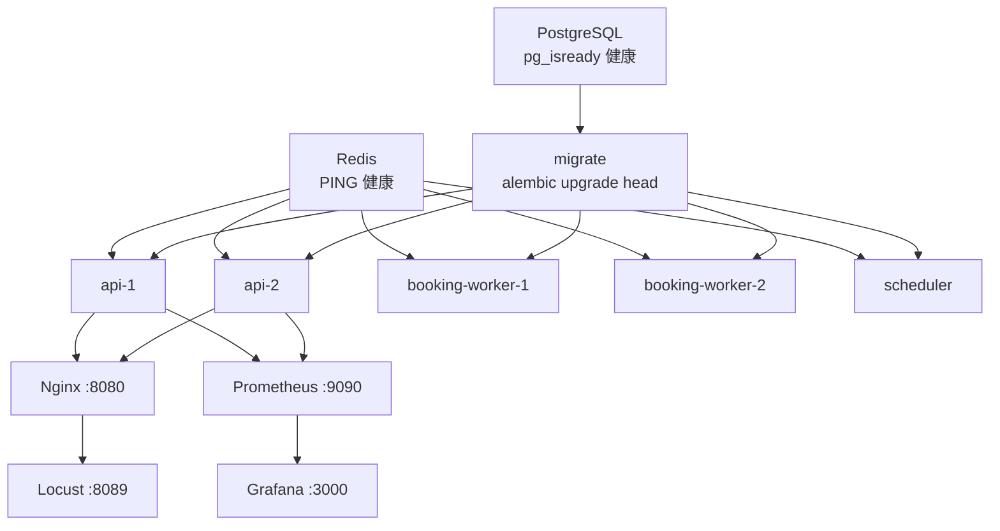
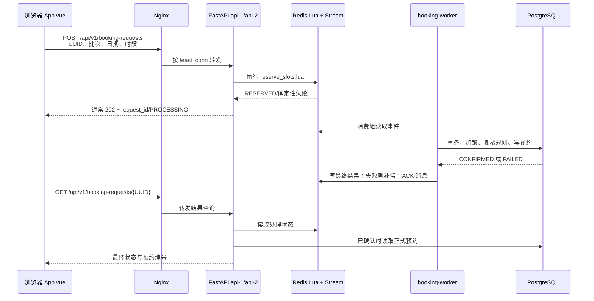

# CampusReserve 项目运行时序与并发处理技术详解

> 面向答辩时的“程序先运行什么、一次预约经过哪些代码、并发请求由谁承担”问题。本文依据当前仓库代码编写；文中的容量机制是实现方式，不等于已经测得的吞吐量或延迟指标。

## 1. 先分清四类代码

| 位置 | 运行角色 | 典型文件 |
| --- | --- | --- |
| [`compose.yaml`](../compose.yaml) 与 `deploy/` | 创建容器、设置依赖、构建镜像、配置 Nginx 和监控 | [`compose.yaml`](../compose.yaml)、[`default.conf`](../deploy/nginx/default.conf) |
| [`apps/`](../apps/) | 三种后端进程的启动入口：API、预约 Worker、定时调度器 | [`api/main.py`](../apps/api/main.py)、[`booking_worker/main.py`](../apps/booking_worker/main.py)、[`scheduler/main.py`](../apps/scheduler/main.py) |
| [`src/campus_reserve/`](../src/campus_reserve/) | 接口、业务规则、Redis/数据库操作、ORM 模型 | `auth`、`venues`、`inventory`、`bookings`、`admin`、`shared` 等 |
| [`web/`](../web/) | 浏览器中的 Vue 页面；收集操作、发 HTTP 请求、显示结果 | [`App.vue`](../web/src/App.vue)、[`AdminPanel.vue`](../web/src/AdminPanel.vue) |

浏览器只通过 HTTP 访问后端。Redis 抢占、数据库事务与权限判定在服务器侧完成，页面上的按钮禁用和状态颜色只用于交互展示。

## 2. 从启动命令到页面可访问

在项目根目录执行 `docker compose up -d --build` 后，Compose 按**依赖条件**启动服务，而不是把所有服务严格排成一条串行队列。相互独立的服务可以同时启动。当前依赖图可概括为：



### 2.1 构建镜像与基础服务

1. [`backend.Dockerfile`](../deploy/docker/backend.Dockerfile) 基于 Python 3.12 安装项目依赖，并复制 `src`、`apps`、迁移脚本等；API、Worker、Scheduler、迁移任务复用该后端镜像。
2. [`frontend.Dockerfile`](../deploy/docker/frontend.Dockerfile) 先运行 Vite 构建 Vue/TypeScript，再把构建产物放入 Nginx 的静态文件目录。
3. PostgreSQL 使用持久化卷 `postgres_data`，通过 `pg_isready` 判断就绪。Redis 使用 `redis_data`，启用 AOF，健康检查执行 `redis-cli ping`。配置见 [`compose.yaml`](../compose.yaml)。Redis 的 `appendfsync everysec` 是持久化策略，不能据此保证任何故障下都零数据丢失。

### 2.2 数据库迁移先于业务进程

`migrate` 容器在 PostgreSQL 健康后运行 `alembic upgrade head`。Alembic 从 [`migrations/env.py`](../migrations/env.py) 读取数据库地址，导入 [`src/campus_reserve/models.py`](../src/campus_reserve/models.py) 中汇总的 ORM 模型，并依次执行 [`migrations/versions/`](../migrations/versions/) 中尚未应用的版本。初次建表、约束与演示数据因此先进入 PostgreSQL。迁移正常结束时，该一次性容器显示 `Exited (0)`。

两台 API、两个 Worker 和 Scheduler 都要求迁移成功且 Redis 健康。它们在条件满足后可并行启动；**Nginx 等待两台 API 的健康接口通过，但其依赖条件并不要求 Worker 已经完成预约消息处理**。

### 2.3 后端进程各自执行什么

- **API**：[`apps/api/main.py`](../apps/api/main.py) 创建 FastAPI 应用，注册认证、场馆库存、预约、管理和健康检查路由，安装请求指标中间件及异常处理器。`api-1` 和 `api-2` 各启动一个 Uvicorn 进程。
- **预约 Worker**：[`apps/booking_worker/main.py`](../apps/booking_worker/main.py) 创建 Redis Stream 消费组，然后循环写心跳、重领超时消息、读取新消息、处理并确认。两个 Worker 使用同一消费组，但各自有不同消费者名称。
- **Scheduler**：[`apps/scheduler/main.py`](../apps/scheduler/main.py) 启动时立即写心跳、同步库存和完成已结束预约；随后安排每 10 秒写心跳、每 30 秒同步库存、每 60 秒归档已结束预约。`max_instances=1` 避免同一调度进程中同类任务重叠执行。
- **Nginx**：[`deploy/nginx/default.conf`](../deploy/nginx/default.conf) 对浏览器提供前端静态文件，并把 `/api/` 请求反向代理到两个 API 实例；Compose 将宿主机 `8080` 映射到 Nginx 容器的 `80`。`/healthz` 只检查 Nginx 自身能否响应。

Prometheus 每 5 秒分别抓取两台 API 的 `/metrics`，Grafana 读取 Prometheus 数据。Locust 是独立压测进程，目标设为 `http://nginx`，不参与预约的日常处理。

## 3. Scheduler 如何把规则变成库存

预约发生前，系统需要有可占用的“场地 × 日期 × 小时”库存。规则来源是 [`venues/models.py`](../src/campus_reserve/venues/models.py) 中的场馆、场地、开放模板和例外日期；结果保存在 [`inventory/models.py`](../src/campus_reserve/inventory/models.py) 的 `ReleaseBatch` 与 `BookingSlot`。

1. Scheduler 调用 `synchronize_inventory()`，依次检查**今天**与默认目标日**明天**，见 [`apps/scheduler/main.py`](../apps/scheduler/main.py)。
2. [`InventoryService.synchronize_target()`](../src/campus_reserve/inventory/services/inventory.py) 读取有效模板、启用场馆、场地和例外日期。当前模板固定 08:00—22:00、每场 60 分钟、提前 1 天 08:00 放号；日期与时间按场馆时区计算。
3. `_plan_slots()` 检查星期掩码，应用整馆或单场地的关闭/临时开放时间，跳过停用和维护场地，再用 `build_slot_windows()` 拆出逐小时窗口。例如一片场地全天开放时生成 14 个时段。
4. 仓储对“场馆 + 使用日期”取得 PostgreSQL 事务级 advisory lock；如果批次已经存在则复用，避免重复生成。尚未到放号时刻的批次为 `READY`、时段为 `UNRELEASED`；到点后批次为 `OPEN`、时段为 `AVAILABLE`。已有 `READY` 批次到点时也会被开放。
5. 对 `OPEN` 批次，Scheduler 将数据库库存及已经确认的用户额度同步到 Redis。初始化脚本 [`initialize_inventory.lua`](../src/campus_reserve/bookings/infrastructure/lua/initialize_inventory.lua) 使用快照指纹：相同快照重试返回已有结果，不同快照不能覆盖当前占位。已开始但未预约的今日时段同步为不可抢占状态。

数据库批次和时段是长期记录；Redis 保存供抢订使用的实时占位。学生的库存接口在开放批次上读取两边信息，展示 `AVAILABLE`、`PROCESSING`、`BOOKED`、`EXPIRED` 等状态，见 [`inventory/controllers/http.py`](../src/campus_reserve/inventory/controllers/http.py)。其中 `PROCESSING`、`EXPIRED` 是展示/实时状态，不是 `booking_slot` 表的两个持久化枚举值。

## 4. 浏览器首次打开后的代码顺序

1. 浏览器访问 `http://localhost:8080/`；Nginx 从前端构建目录返回 HTML、JavaScript、CSS。开发模式访问 Vite 的 `5173` 端口时，`/api` 由 [`vite.config.ts`](../web/vite.config.ts) 代理，不经过 Nginx。
2. [`web/index.html`](../web/index.html) 加载 [`web/src/main.ts`](../web/src/main.ts)，挂载根组件 [`App.vue`](../web/src/App.vue)。
3. `App.vue` 的 `onMounted()` 尝试用 `sessionStorage` 里的 JWT 恢复登录，并调用 `/api/v1/system/health` 检查 API 到数据库和 Redis 的连通性。
4. 未登录时显示登录页。`login()` 向 `/api/v1/auth/login` 发送账号密码；[`auth/services/authenticate.py`](../src/campus_reserve/auth/services/authenticate.py) 查找有效用户并校验密码哈希，[`auth/security.py`](../src/campus_reserve/auth/security.py) 签发限时 JWT。
5. 学生登录后并行请求今天或明天的库存、本人正式预约，并恢复本浏览器保存的请求 UUID。管理员登录后显示 [`AdminPanel.vue`](../web/src/AdminPanel.vue)，调用 `/api/v1/admin/...`。

后续请求的 `Authorization: Bearer <token>` 由 [`auth/dependencies.py`](../src/campus_reserve/auth/dependencies.py) 校验签名和到期时间。管理接口还会核对数据库中用户仍有效且角色与令牌一致，见 [`admin/controllers/http.py`](../src/campus_reserve/admin/controllers/http.py)。

## 5. 一次高并发预约的完整链路



### 5.1 浏览器先保留可找回的请求 UUID

[`App.vue` 的 `submitBooking()`](../web/src/App.vue) 从页面读取时段 ID、批次 ID 和使用日期，先把请求 UUID、日期和时段说明保存到按用户 ID 分开的浏览器 `localStorage`，再发送 HTTP 请求。因此网络超时后仍可在“预约请求记录”里继续查询。它只在前端限制一次最多选两个时段；服务端会独立校验。查询结果约 5 秒仍未确定时，页面保留 `PROCESSING` 和“继续查询”按钮。

### 5.2 API 在 Redis 中快速抢占

[`bookings/controllers/http.py`](../src/campus_reserve/bookings/controllers/http.py) 限制提交者为学生，调用 [`RedisAtomicReservationService.reserve()`](../src/campus_reserve/bookings/services/redis_reservation.py)。实际检查和修改集中在一次 [`reserve_slots.lua`](../src/campus_reserve/bookings/infrastructure/lua/reserve_slots.lua) 调用中：

1. 检查 Redis 键类型及参数，然后按请求 UUID 和内容指纹检查幂等性：相同 UUID、相同内容复用结果；相同 UUID、不同内容拒绝。
2. 对新请求检查批次的使用日期和 `OPEN` 门闩。
3. 检查一次选 1～2 个不同的时段，目标时段存在且状态为 `AVAILABLE`。
4. 检查该用户在该批次已占用数加本次数量不超过 2；允许同一时间选择不同场地，两片都计入额度。
5. 在同一次脚本执行中写 Stream 事件、把场地标成 `RESERVED:<request_id>:<user_id>`、增加用户额度并缓存请求状态。

Lua 脚本在 Redis 中整体执行，其他预约命令不会插入其检查与写入过程。**Redis 的 `RESERVED` 表示抢占成功，仍需数据库确认**；API 通常返回 HTTP 202 与 `PROCESSING`，而不是直接宣布正式预约成功。确定性拒绝则返回对应错误。

### 5.3 Worker 异步确认数据库事实

两个 Worker 通过同一 Stream 消费组分配事件。每个 Worker 每轮先尝试 `XAUTOCLAIM` 重领超时未确认事件；没有时用 `XREADGROUP` 读取最多 10 条新事件，并**逐条**处理，见 [`apps/booking_worker/main.py`](../apps/booking_worker/main.py) 和 [`stream_booking.py`](../src/campus_reserve/bookings/services/stream_booking.py)。这里的“每次读取 10 条”不表示单个 Worker 同时并行执行 10 个数据库事务。

`BookingEventProcessor.process()` 为事件建立数据库事务，并调用 [`SyncBookingService.submit()`](../src/campus_reserve/bookings/services/sync_booking.py)：

1. 先锁请求 UUID，处理同一请求的重复投递；再锁“用户 + 使用日期”，读取并锁定所选库存行。
2. 复查时段同日同批次、批次 `OPEN`、时段 `AVAILABLE`、开始时间未过、每天最多两个时段。
3. 创建 `BookingRequest`、`Booking`、`BookingItem`、状态日志，更新 `BookingSlot` 为 `BOOKED`，增加 `UserDailyUsage`。预约编号形如 `CR-使用日期-UUID片段`。
4. 在一个数据库事务中提交。`BookingItem.slot_id` 的唯一约束和其他表约束提供最终防重复占用保护，见 [`bookings/models.py`](../src/campus_reserve/bookings/models.py)。

随后 Worker 把 `CONFIRMED` 及正式预约编号写回 Redis，并对 Stream 消息执行 `XACK`。若数据库确定性失败，先运行 [`compensate_reservation.lua`](../src/campus_reserve/bookings/infrastructure/lua/compensate_reservation.lua)，仅释放仍属于该 UUID 的占位和额度，再记录失败和确认消息，避免误放其他人的库存。

### 5.4 异常、重试和结果找回

Worker 在尚未安全写入最终结果前不会 ACK。异常消息留在消费组待处理列表；空闲达到默认 30 秒后，Worker 可重领。默认最多投递 5 次；超过上限会核对数据库已提交结果，必要时补偿失败占位，并写入死信 Stream 以便排查。数据库已成功、Worker 在 ACK 前中断的情况下，重处理依赖请求 UUID 的幂等逻辑识别已有预约。

前端用 `GET /api/v1/booking-requests/{request_id}` 查询：处理中可读取 Redis 暂存状态；已确认时接口核对数据库正式记录。浏览器“我的预约”通过 `GET /api/v1/bookings` 读取已落库预约，不能用本地请求记录代替。Redis 请求结果默认保留 7 天；浏览器本地记录按账号分开保存。

## 6. 代码怎样分担高并发压力

| 层次 | 当前实现 | 解决的问题与边界 |
| --- | --- | --- |
| Nginx | `least_conn` 把 `/api/` 分给 `api-1`、`api-2`；普通 API 每来源 IP 配置 `6000r/s`、`burst=10000`，登录单独配置 `10r/s`、`burst=20` | 分担 HTTP 连接并限制异常流量；配置速率不是已实现的吞吐量。直接访问宿主机 `8000` 会绕过 Nginx。 |
| API | 异步 FastAPI 接口；提交阶段主要调用 Redis 脚本，不在 HTTP 请求里等待完整数据库落库 | 缩短请求占用时间；若 Redis 不可用，提交链路仍会失败。 |
| Redis Lua | 一次脚本完成库存检查、额度检查、幂等处理、占位和消息入队 | 避免多个 API 实例并发时的“先查后改”竞争；单个 Redis 实例仍有资源上限。 |
| Redis Stream + 2 Worker | 把确认工作排队；两个消费者分工，异常消息可重领 | 缓解数据库瞬间写入压力；队列积压会增加最终确认等待时间，不能凭“已排队”认为已完成。 |
| PostgreSQL | 事务级 advisory lock、库存行锁、唯一约束、每日额度约束 | 在并发、重放或 Redis 状态异常时提供最终数据保护；锁竞争和磁盘能力仍限制写入吞吐。 |
| 幂等与补偿 | 请求 UUID/指纹、已有请求复用、按占位所有者释放、死信 | 处理重复请求和部分故障；失败事件仍需结合日志及死信排查。 |

**为什么同一时间可以订两片不同场地？**当前规则限制的是“学生每天最多两个场地时段”，而不是禁止同一时间占两片不同场地。Redis 脚本和数据库服务都按所选时段数量计入额度；同一 `slot_id` 仍不能重复占用。

## 7. 管理操作和后台任务怎样影响预约

管理员在 [`AdminPanel.vue`](../web/src/AdminPanel.vue) 发起场地状态、模板、例外日期、库存批次、签到等请求；[`admin/controllers/http.py`](../src/campus_reserve/admin/controllers/http.py) 检查角色，[`admin/services.py`](../src/campus_reserve/admin/services.py) 执行规则和审计。批次的发布、开放、暂停、恢复、关闭改变数据库状态；暂停与关闭也修改 Redis 的批次门闩，因此新的 Lua 占位会被拒绝。管理端的批次状态与学生实时库存展示需要一起看。

管理员签到创建 [`checkins/models.py`](../src/campus_reserve/checkins/models.py) 的记录，并更新预约状态；对已有签到返回原记录。Scheduler 每 60 秒调用 `archive_completed_bookings()`，把所有时段已结束的有效预约归档为 `COMPLETED`；这项任务与 Worker 的“刚提交时确认预约”属于不同阶段。

## 8. 怎样观察运行结果，压测结论能说明什么

启动后可在项目根目录执行：

```powershell
docker compose ps -a
docker compose logs --tail 80 nginx api-1 api-2 booking-worker-1 booking-worker-2 scheduler
Invoke-RestMethod http://localhost:8080/api/v1/system/health
```

- `/api/v1/system/health/live` 只说明 API 能响应；`/api/v1/system/health` 另执行 PostgreSQL `SELECT 1` 与 Redis `PING`。Worker、Scheduler 的 Compose 健康检查只看它们写入 Redis 的心跳，不等于预约全链路成功。
- 两台 API 的请求次数和耗时由 [`shared/metrics.py`](../src/campus_reserve/shared/metrics.py) 暴露到 `/metrics`；[`prometheus.yml`](../deploy/prometheus/prometheus.yml) 分别抓取两个实例，可在 Grafana 中查看趋势。
- 当前 [`tests/load/locustfile.py`](../tests/load/locustfile.py) **只请求 `/api/v1/system/health/live`**。在 `http://localhost:8089/` 展示的 RPS、延迟和错误率，只能说明 Locust → Nginx → API 健康接口这条路径的结果，不能作为预约写入性能、最终确认延迟或零超卖的实测证据。
- 若要验证预约全链路，应另行准备足量学生账号、已开放的场地时段和真实预约请求；同时观察请求受理率、最终 `CONFIRMED/FAILED` 数量、确认耗时、Stream 待处理量、数据库唯一约束结果与是否超卖。峰值目标必须以实际测试环境和结果报告为准。

## 9. 答辩时按顺序讲的简版

1. **启动**：Compose 先启动 PostgreSQL、Redis；数据库迁移完成后，API、两个 Worker、Scheduler 启动；Nginx 在两台 API 健康后对外提供 8080 页面。
2. **准备库存**：Scheduler 按模板与例外规则生成今天/明天的日期批次和小时场地时段，并把开放批次同步到 Redis。
3. **接收请求**：浏览器先保存 UUID；Nginx 分流到 API；Redis Lua 原子检查额度和库存，占位后把事件写入 Stream，API 返回处理中。
4. **最终确认**：两个 Worker 消费事件；PostgreSQL 事务重查规则、锁定库存并写正式预约；成功写回结果，失败按请求所有者补偿占位。
5. **向用户反馈**：浏览器按 UUID 查询最终结果；正式预约从数据库读取。管理员可管理批次与签到，Scheduler 后续归档已结束预约。
6. **说明性能证据**：上述结构用于承担并发，但目前仓库的 Locust 脚本只测健康接口；预约吞吐与零超卖需要单独的全链路压测和数据库核验。
